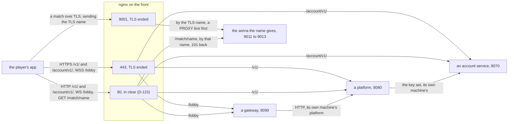

# System topology

This page describes the shape of the backend: which processes exist, what runs on which machine,
how traffic flows, and how the capacity budget is worked out. It is for engineers and operators who
are new to the project, and it is the page to read before the detailed designs.

Three other pages go with it:

- The [requirements](../requirements/01-scope-and-nfrs.md) say what the backend must achieve.
- The [decision log](03-decision-log.md) says why each choice was made. A decision is cited as D-_n_.
- The [availability model](02-availability.md) says what happens when parts fail.

Words such as *front*, *arena*, *stay*, *grant* and *TLS name* are defined in the
[glossary](../glossary.md).

## 1. Four process types

The backend is split by **workload shape**, meaning how a process uses CPU, memory and the network.
It is not split by business domain.

One JVM already uses every core it is given. The arena runs one thread per room, so one arena keeps
24 cores busy without any split into services. A split by domain (an auth service, an inventory
service, a guild service, each behind a network hop) buys independent deployment and team
boundaries. With one developer and three machines, neither benefit applies. The costs would be
permanent: latency, service discovery, distributed transactions and tracing
([D-4](03-decision-log.md#d-4--split-by-workload-shape-not-by-business-domain)).

| Process | Shape | Owns | Scales with | Instances |
|---|---|---|---|---|
| `arena` | CPU-bound, latency-critical, holds state in memory | the live rooms; never touches MySQL | players in battle | 7 on three machines (2 or 3 a machine), reached through the front's nginx by name ([D-82](03-decision-log.md#d-82--one-public-address-for-the-site-nginx-in-front-ending-tls-routing-match-traffic-by-name)); 3 at launch |
| `gateway` | IO-bound, many idle connections, thin | the clients' lobby connections, the auth handshake, routing to `platform` | concurrent players | 3, one a machine; 1 at launch |
| `platform` | request and response, bound by the database | every platform module (below), and the watch, the backend's own monitoring ([D-86](03-decision-log.md#d-86--monitoring-is-the-backends-own-a-watch-in-every-platform-the-runbooks-rules-in-code-alerts-in-the-store-sent-by-webhook)) | lobby traffic | 3, one a machine; 1 at launch |
| `worker` | throughput-bound, asynchronous | results, rewards, tournaments, seasons, retention, analytics, the backups' state in its metrics | the rate of events | 2, or as many as the result rate needs ([05 §1](../detailed-design/05-worker-and-events.md#1-why-a-stream-and-not-a-queue): about 10 results a second each on the development machine); 2 at launch |

Inside `platform` the module boundaries stay strict: auth, player, team, rooms, matchmaking,
tournament, leaderboard, economy, items, social and notify (see
[detailed-design/04](../detailed-design/04-platform-services.md)). Moving `economy` into a process of
its own later must be a change to the build files, not a rewrite. Split a module out only when it
clearly needs its own scaling or its own failure behaviour, not on principle.

**Beside the four, the account service**
([D-117](03-decision-log.md#d-117--accounts-in-an-account-service-of-their-own-which-issues-signed-tokens-the-backend-takes-once-for-a-session),
2026-11-26): sign-up, login, the passwords and the tokens, in a system of its own that the owner wants apart, as an
OAuth 2.0 authorization server is beside the services that trust it. It is not a fifth process type: D-4's split
stands for the backend, and the account service shares nothing of it but MySQL's server, where its database is its
own (`account`), and the front's nginx (`/account/v1/`). It runs one a machine, on 8070, stateless but for MySQL, so
nginx sends to any; one at launch. The platform takes its access token once, for a session, checked against the key
set it reads from it ([detailed-design/10](../detailed-design/10-accounts.md)).

Several JVMs on one machine are still right, even with ZGC, for **crash isolation**: one fatal
error takes down one arena's rooms, not all of them (NFR-8).

## 2. Machine topology

**The site has one public address** since
[D-82](03-decision-log.md#d-82--one-public-address-for-the-site-nginx-in-front-ending-tls-routing-match-traffic-by-name):
an IP address, with no domain. The provider forwards three of its ports, 80, 443 and 9001, to one
machine, called **the front**. nginx on the front takes every connection a player makes:

- **443**: nginx ends TLS. It sends the API (`/v1/`) to a platform, sign-up and login
  (`/account/v1/`) to an account service, and the lobby (`/lobby`) to a gateway.
- **9001**: nginx ends TLS and passes each match connection to one arena. It picks the arena by the
  name the client sent in the TLS handshake (the arena's **TLS name**, for example
  `a1.arena.internal`). Before the client's bytes, nginx sends the arena one PROXY line with the
  phone's address ([D-105](03-decision-log.md#d-105--an-arena-behind-the-front-knows-the-phones-address-nginxs-proxy-line-read-once)).
- **80**: the same API, account service and lobby without TLS, and matches without TLS. A client without TLS asks
  for its arena by name with `GET /match/<the grant's tlsName>` and an HTTP upgrade
  ([D-115](03-decision-log.md#d-115--a-players-build-may-connect-without-tls-and-the-site-serves-it-on-80-matches-included)).
  What crosses 80 is readable by anyone on the way.

nginx passes everything on over the private network, to a platform, an account service, a gateway or
an arena on any of the three machines. Every machine is set up as a front, so the provider can forward to another one
if the front is lost. The certificate nginx serves comes from the backend's own certificate
authority (CA), whose root certificate the app ships and trusts
([operations/06](../operations/06-certificates.md)).

The diagram shows the routes through the front. On three machines the arrows cross the private
network; on the launch's one machine they stay on loopback.

The three machines of the design, with each role's allocated cores and memory:

| | Machine A | Machine B | Machine C |
|---|---|---|---|
| nginx | 1c / 1G | 1c / 1G | 1c / 1G |
| gateway | 2c / 4G | 2c / 4G | 2c / 4G |
| platform | 2c / 4G | 2c / 4G | 2c / 4G |
| account service | 1c / 2G | 1c / 2G | 1c / 2G |
| worker | — | — | ×2, 4c / 4G |
| arena | ×2, 8c / 16G | ×3, 12c / 24G | ×2, 8c / 16G |
| MySQL | **primary** 6c / 20G | — | replica 3c / 20G |
| j-redis `session` | **primary** 2c / 8G | replica 1c / 8G | — |
| j-redis `events` | — | **primary** 2c / 8G | replica 1c / 8G |
| **allocated** | 22c / 55G | 21c / 51G | 22c / 59G |

j-redis is the backend's own store, compatible with Redis. It runs as two instances of the same
binary, with different ports and data directories:

- `session` holds sessions, tickets, presence, the matchmaking queues and the leaderboards;
- `events` holds the durable streams, the match results among them.

They are separate so that a backlog of events can never evict a session, and so that the two fail
independently ([D-7](03-decision-log.md#d-7--two-j-redis-instances-not-one)).

**The account service's row** (added 2026-11-26, D-117): its heap is 1 GiB, fixed, for the hasher's line at its
full eight, about 150 MiB live ([10 §6.1](../detailed-design/10-accounts.md#61-the-release)); 2G with the JVM's own
memory. One core is its steady state: a password login is 88 ms of one core (Argon2id), and the common ways back in
hash nothing, a session lasting a day and an app whose session ended refreshing its access token. 50 000 players
logging in by password once a day is about 0.6 a second, a twentieth of a core. A login herd is held by the hasher's
line, eight hashes at once and 160 waiting, then 503 `busy` with `Retry-After`, about 90 logins a second for each
account service; its bursts borrow the machine's slack, as the platform's Argon2 did before D-117.

The allocations are ceilings, not steady-state use. The arenas' 28 allocated cores carry a load of
about 25 cores at full occupancy. Each arena is set for 1 800 players in battle (12 rooms of 150).
That is short of the point where its two network threads fill, 2 100 to 2 300 players. At full,
each arena's rooms use about 2.9 cores.

**The launch: one machine** ([D-93](03-decision-log.md#d-93--the-site-launches-on-one-machine-for-up-to-about-5-000-players),
decided by the owner on 2026-11-01). The site launches for up to about 5 000 players on one
machine. That machine is the front, and it holds every role in the table above, with the same
names and ports, on loopback:

- nginx;
- one platform, one account service and one gateway;
- the arenas `a1` to `a3`, 5 400 places;
- the workers `c1` and `c2`;
- the stores `session` and `events`, with no replica;
- MySQL's primary, with no replica;
- the backups, beside MySQL.

The recommended machine has 32 cores, 64 GB of memory and two disks. Its heaps are sized for one
machine (the table in D-93). This replaces the earlier launch target, 5 000 to 10 000 players on two
machines with replication, whose layout was never written. Nothing fails over until there is a
second machine ([02](02-availability.md#on-one-machine-the-launch-d-93)).

Growing to two machines is plan item 115, in two halves:

1. A second machine, B, becomes the first one's standby. It runs the replicas of MySQL and of both
   stores; the rest of A is installed on it and stopped
   ([operations/10](../operations/10-two-machines.md), D-96).
2. B runs three arenas of its own, `b1` to `b3`, behind A's nginx. The site then has six arenas
   and 10 800 places ([operations/10 §10](../operations/10-two-machines.md#10-arenas-on-b), D-97).

## 3. Capacity model

Everything follows from **bytes per player per second**. How the backend keeps that number small
is in [detailed-design/02-networking](../detailed-design/02-networking.md): the client simulates
bullets and shapes itself, the send rate follows the tanks, and each client has a budget of
entities.

### Per player, in battle

| Direction | Rate | Content | Bytes |
|---|---|---|---|
| Down | 15 Hz | ~12 visible tanks × 6 B, a header, create and destroy events | 122 B payload (the reference frame, [02 §4](../detailed-design/02-networking.md#4-the-snapshot)) + ~71 B packet overhead; 79 B measured at the design density |
| Up | 10 packets/s | one input in each, the movement and aim held then (02 §9) | ~16 B payload + ~71 B overhead |
| | | **Total** | **~3.7 KB/s ≈ 13.4 MB/hour budgeted; ~3.1 KB/s ≈ 11 MB/hour measured** |

At these payload sizes the overhead of each packet (IP + TCP + TLS + framing ≈ 71 B) is 37 % of the
downstream traffic. That is why the send *rate* matters more than shaving bytes off each message.

### System totals

| In battle | Rooms of 150 | Egress | Ingress | Arena cores |
|---|---|---|---|---|
| 100 % (50 000) | 333 | 1.1 Gbit/s | 0.35 Gbit/s | ~25 |
| 70 % (35 000) | 233 | 0.77 Gbit/s | 0.25 Gbit/s | ~17 |
| 50 % (25 000) | 167 | 0.55 Gbit/s | 0.18 Gbit/s | ~12 |

### Core budget

| | arena | gateway | platform | account service | worker | j-redis | MySQL | nginx | OS | total |
|---|---|---|---|---|---|---|---|---|---|---|
| Cores | 25 | 6 | 6 | 3 | 3 | 4 | 6 | 2 | 6 | **61 of 72** |

An arena's cores go to three things: the simulation, the encoding of snapshots, and the socket
writes (~750 000 a second at full occupancy). Encoding was measured on the development VM at 2.1 to
2.2 ms p50 for each round of 150 clients ([tick benchmark](../../backend/README.md#the-tick-benchmark)).
That is 15 × 2.15 ≈ 32 ms per room per second, or ~10.7 cores across 333 rooms: four times the
~0.5 ms first estimated. The 11 spare cores are the margin for bursts, garbage collection and
measurement error. They are not capacity to sell.

**Socket I/O is the largest part, and it is not in the 25 cores.** It was measured on the
development machine on 2026-09-30, in the load run
([07 §4](../detailed-design/07-threading-and-performance.md#4-tick-budget-and-what-to-measure)):

- A full room cost 0.26 cores in all: 0.11 on its room thread and 0.15 as its share of the network
  threads. Three quarters of the network threads' share was the kernel's.
- At that rate, 333 rooms need ~87 cores, more than the three machines have.
- It is an upper bound. The bots ran on the same machine, over loopback, where the kernel also does
  the receiving side's work, and the machine was a shared virtual machine.
- One process's two Netty workers would be full near 2 100 players. A process would need about
  7 000, if 333 rooms were spread over seven arenas.

Whether the model holds is for Q-3 to settle, with the bots on another machine and the production
network cards. Until then the 50 000 is unproven, and so is the shape of the arena process.

**The simulation is measured, and is much cheaper than assumed.** The first estimate was
25 Hz × ~2 ms = 50 ms per room per second. The
[tick benchmark](../../backend/README.md#the-tick-benchmark) measures **0.217 ms per tick, 5.4 ms
per room per second**: about ten times less, ~1.8 cores across 333 rooms instead of ~17. That does
not shrink the arena budget by the same factor. Encoding costs about six times the simulation, and
the socket writes, measured since (above), cost more than both. The simulation is not the
constraint; the encoder is, and after it the writes.

**Measured again on 2026-10-06** ([operations/04](../operations/04-scaling-and-performance.md)), on
the current build, with bots sending what a client sends. The figures above are older: from before
the class tree and the benchmark's fix T-53, and, for the load run, from bots that sent twice a
client's input (T-54).

- **A full room costs about 0.24 cores** in a running arena: 0.13 for its share of the network
  threads, 0.10 on its room thread. This was over loopback, so it is an upper bound.
- **A mature room at the design density costs 11.6 % of a core** for its simulation and encoding
  alone (1.72 ms simulation p50, 4.61 ms to encode a round).
- **An arena's two network threads fill near 2 300 players.**

At 50 000 players that is ~80 arena cores and ~22 arena processes, against the 28 cores allocated
and the 7 arenas named here. At 10 000, the launch target of that day, it is ~16 cores and 5
processes. At today's launch of 5 000 on one machine (D-93) it is ~8 cores and 3 processes
([operations/04 §5](../operations/04-scaling-and-performance.md#5-what-50-000-players-would-take-on-these-numbers)).
Q-3 settles which figures hold, on the production hardware. **The seven arenas of D-82** carry
12 600 players in battle as set. That is enough for 10 000 all in battle, but not for 50 000. For
50 000 the site needs more arenas than these machines' network threads give, or the threads raised
(a code change, not made).

**Provision 10 GbE.** At 50 000 all in battle the egress, 1.1 Gbit/s, is more than a 1 Gbit uplink carries; even
at 70 % in battle its 0.77 Gbit/s is 77 % of the line, which leaves too little for bursts. Since D-82 the front's link carries the site's traffic twice,
once on the public side and once on the private side: about 1.5 Gbit/s each way at 50 000, and
about 0.15 Gbit/s each way at the launch's 5 000. The front's nginx allocation above (1c / 1G) is not
measured for that load.

## 4. Client flow end to end

One player's path, from opening the app to the rewards of a match. Each step names the process
that acts and what it writes.

1. **Launch and login.** The app reaches the front's nginx on the site's one public address, an IP
   with no domain. It uses HTTPS on 443, with the certificate from the backend's own CA, whose root
   the app ships (D-82). A client without TLS uses HTTP on 80 instead (D-115).
   - The platform checks the login against MySQL and writes a session in j-redis:
     `HSET sess:{token} playerId …`, with `EXPIRE` a day ±10 %.
   - The app then opens the lobby, `wss://…/lobby` (or `ws://…/lobby` on 80). nginx passes it to a
     gateway, and the app authenticates with the session's token.
2. **Lobby.** The player sees their profile, team, shop, inventory and tournaments. Requests go
   gateway → platform → MySQL or j-redis.
3. **"Play now".** The platform picks an arena from the arena directory. The arena places the
   player in one of its rooms itself. The queued modes are matched and confirmed first
   ([04 §4](../detailed-design/04-platform-services.md#4-matchmaking)), and their room is made by
   the first ticket that names it (D-20).
   - The platform writes the join ticket, with the loadout already resolved:
     `HSET ticket:{id} playerId, name, team, match, mode, bonus, skin`, `EXPIRE 60`.
   - It replies with the grant: `{ arenaHost, arenaPort, ticketId, tls, tlsName }`. On the site
     these are the site's address, 9001, the ticket, `true`, and the arena's name.
4. **Connect to the arena.** A client with TLS opens TCP to `arenaHost:arenaPort`, the front's 9001.
   Its TLS handshake sends `tlsName` and checks the certificate against it. The front's nginx ends
   TLS and passes the connection, in plaintext, to the arena that name maps to, on its private
   address. A client without TLS opens TCP to the front's 80 instead and sends
   `GET /match/<tlsName>` with `Upgrade: backend-match`; the arena answers `101`, and the
   connection then carries the same frames (D-115). Either way the client then sends
   `Join{ticketId}`.
   - The arena claims the ticket: `MULTI · HGETALL ticket · DEL · EXEC`, so it is used once. It
     validates the ticket and spawns the tank.
5. **In the match.** The client sends at most 20 inputs a second, two to a packet. The arena sends
   snapshots at the rate of the client's traffic profile: 15 Hz, or 10 Hz at `saver`.
   - Tanks are updated in every frame.
   - Bullets are created once and extrapolated by the client.
   - Shapes are updated only when they move.
6. **Match end.** The arena first spools the result to its local disk. It then adds the result to
   the stream on the `events` store:
   `XADD s:match-result MINID ~ <now − BACKEND_RESULT_RETENTION_HOURS, 24 by default (D-83)> * e {json}`.
   - A worker reads it as the consumer group `rewards`: `XREADGROUP GROUP rewards <workerId>`.
   - It applies it in one MySQL transaction (experience, currency, statistics), then updates the
     leaderboards with `ZADD ... GT`, then acknowledges the entry with `XACK`.
   - Results went through a list until 2026-09-29. The list `q:match-result` stays as an inbox
     ([05](../detailed-design/05-worker-and-events.md)).
7. **Back in the lobby.** The worker pushes what the result paid, `evt.rewards`, through the gateway
   that holds the player's lobby connection
   ([05 §6](../detailed-design/05-worker-and-events.md)). The app reads the wallet and the inventory
   over the API.

## 5. Data plane and control plane

The rule that matters most at 50 000 players is which path each kind of traffic takes:

| Path | Transport | Through nginx? | Through gateway? |
|---|---|---|---|
| Match traffic over TLS (client ↔ arena) | TCP + TLS on 9001. nginx's `stream` module ends the TLS on the front and passes the connection by the arena's name (D-82) | **yes**, passed through by name | **no** |
| Match traffic in clear (client ↔ arena) | TCP on 80: `GET /match/<name>`, answered `101` by the arena, then the same frames (D-115) | **yes**, passed through by name | **no** |
| Lobby (client ↔ gateway ↔ platform) | WebSocket with JSON on `/lobby`: over TLS on 443, or in clear on 80 | yes | yes |
| API: accounts, login, match requests, leaderboards, the shop (client ↔ platform) | HTTP with JSON on `/v1/`: HTTPS on 443, or in clear on 80 | yes | **no** |
| Match results (arena → worker) | the j-redis `events` stream `s:match-result` (and the `q:match-result` inbox) | no | no |
| Commands (platform → arena) | j-redis pub/sub on `arena-admin:{name}`: an operator's kick and room close ([04 §10](../detailed-design/04-platform-services.md#10-admin-api)) | no | no |
| System of record | MySQL | no | no |

Passing 1.1 Gbit/s of match traffic through a gateway would double the load on the internal
network. It would also add a hop to the one path that cannot afford it. The matchmaker hands out a
specific arena, by its name since D-82. **The allocator is the load balancer for match traffic, not
nginx**: nginx only follows the name it was given
([D-5](03-decision-log.md#d-5--match-traffic-never-passes-through-nginx-or-the-gateway), revised by
D-82). Since D-82 the front's nginx does carry match traffic, with that extra hop and that load, but
it routes only by the name the allocator gave.

There is no virtual IP address and no keepalived. The client holds the site's address and retries
on failure. With one public address since D-82, a lost front is covered by the provider forwarding
the address to another machine.

## 6. Technology choices

The reason for each choice is in the [decision log](03-decision-log.md).

| Concern | Choice |
|---|---|
| Language | Java 21 (Temurin), on the release's own runtime, made by `jlink` ([D-77](03-decision-log.md#d-77--everything-the-backend-builds-and-runs-with-is-in-the-repository-and-in-the-release), [09 §4.1](../detailed-design/09-release-and-packaging.md#41-the-runtime)) |
| GC | Generational ZGC (`-XX:+UseZGC -XX:+ZGenerational`) |
| Network | Netty 4.2, native epoll, raw TCP. The front's nginx ends match traffic's TLS (D-82). The arena has TLS of its own, from the JDK's provider, used only where there is no front. Not `netty-tcnative`: it is a native library for each platform, for a speed nobody has measured a need for ([02 §1](../detailed-design/02-networking.md#1-transport)) |
| Wire format | Hand-written binary; deltas against the last frame sent, in world space ([D-16](03-decision-log.md#d-16--deltas-are-measured-against-the-last-frame-sent), which superseded D-11's baseline by acknowledgement) |
| Database | MySQL 8.4 LTS, the release's own (D-77, Q-56), with `mysql-connector-j`, HikariCP and Flyway |
| Cache and coordination | [j-redis-service](../../j-redis-service/README.md), two instances |
| Events | j-redis streams (since j-redis 2.1, 2026-09-29; D-33) |
| Leader election, singleton jobs | Leases in the `session` store, `SET NX` with an expiry: the matcher (`mm:leader`), the ledger check, a season's close. Each job is safe to repeat, so a lease needs no fencing token ([02 §5](02-availability.md#5-prerequisites-still-missing)). No cluster-membership library: JGroups and Apache Ratis are in the offline bundle and not used ([D-12](03-decision-log.md#d-12--embedded-libraries-yes-installed-daemons-no)) |
| Metrics and monitoring | Each process serves its metrics in the Prometheus text format on a loopback HTTP endpoint, written by hand (`common/Metrics`), because the format is a few lines. The offline bundle's Micrometer and Prometheus registry are not used. Tick times go through HdrHistogram ([operations/01 §7](../operations/01-deploy.md#7-installing-a-machine)). The metrics are read by the watch in every platform, the backend's own code, which applies the runbook's alert rules and sends alerts by webhook. No Prometheus server or other monitoring service runs (D-86, [operations/08](../operations/08-monitoring.md)) |
| Config tables | The simulation's balance (stats, levels, shapes, classes, modes) is code, in `sim` and `handoff/MatchMode`. Loading it from JSON is not built, and not wanted yet (Q-27). `platform`'s tables are JSON, read at boot with Jackson and checked strictly: `items.json`, `packs.json`; the shop's offers are rows of `shop_offer`, edited by the admin API (D-119) |
| Logging | SLF4J and Logback, with an async appender: the thread that logs never waits for the journal ([T-10](../defects.md#4-concurrency)) |
| Build | Maven, many modules. The release has one `lib/<process>/` of plain jars for each process type, so the MySQL driver stays off an arena ([operations/01 §7](../operations/01-deploy.md#7-installing-a-machine)); only `tools` is a shaded jar. The build runs offline, from [`java21-offline`](../../java21-offline/README.md), with the JDK and Maven committed in `vendor/` (`build-offline.sh`, [09 §3](../detailed-design/09-release-and-packaging.md#3-the-build-from-the-repository-alone)) |
| Process management | systemd; CPU pinning by a `CPUAffinity=` drop-in for each arena and store |

Every third-party choice is an **embedded jar**, never an installed service. MySQL and nginx are
the only third-party daemons on the machines (C-6). j-redis, the backend's own store, runs beside
them (C-7). The release carries all three, and the Java runtime, instead of the operating system's
packages, and runs them from `/opt/backend` (D-77).

## 7. Core principles

1. **One writer for each piece of state.** Only its room thread touches a room's state; only its
   command thread touches j-redis's dataset. Everything else goes through queues. There are no
   locks on hot paths.
2. **The arena is authoritative and never blocks.** A room thread does no database call, no disk
   access and no synchronous remote call.
3. **The latest state beats history.** Snapshots can be dropped. A client that has fallen behind is
   skipped for this tick, not queued.
4. **Zero allocation in the tick loop**, on the server *and* in the Unity client, where garbage
   collection shows up as frame hitches.
5. **Side effects are idempotent.** Every result, purchase and reward carries an id, and consumers
   drop duplicates. A crash becomes a retry, not corruption.
6. **Balance is data.** Tanks, shapes, the experience curve and the mode rules live in tables of
   data, apart from the logic that reads them: in code for the simulation (`sim/Content`,
   `ClassTable`, `MatchMode`, Q-27), and in JSON for `platform`'s items, shop and packs.
7. **Fail small.** A room crashes: the room restarts. An arena crashes: only its rooms are lost.
   j-redis restarts: clients reconnect with backoff, and arenas spool results to disk.
8. **Every byte on the wire costs a player money.** Mobile data is the budget that drives the
   protocol, not server bandwidth.
