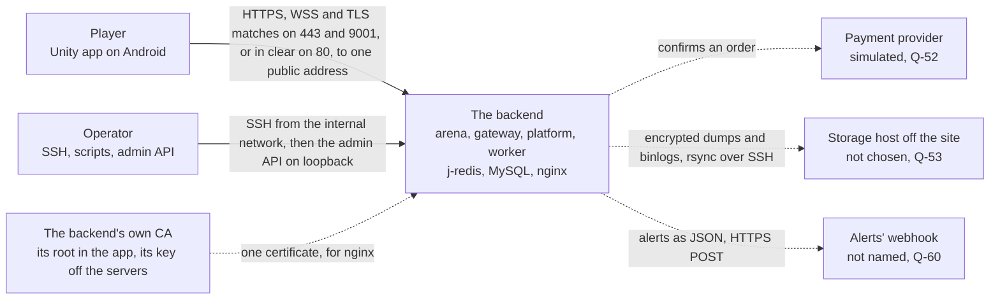
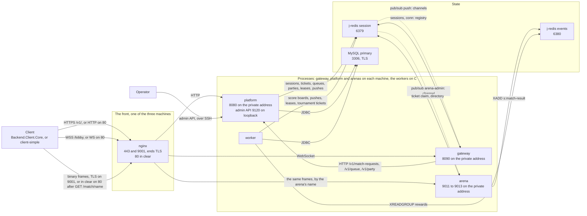
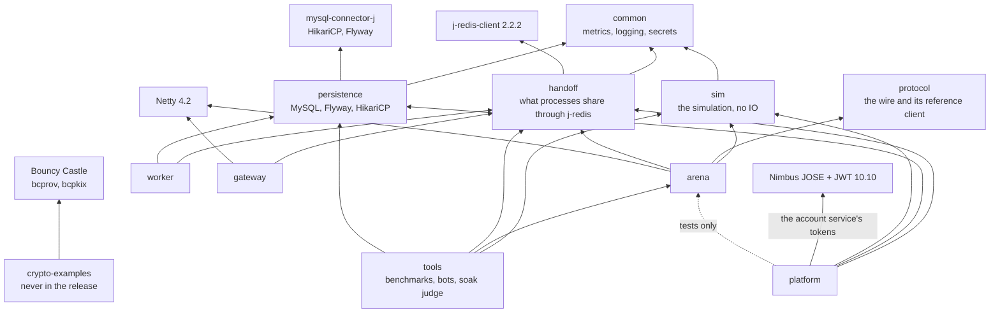
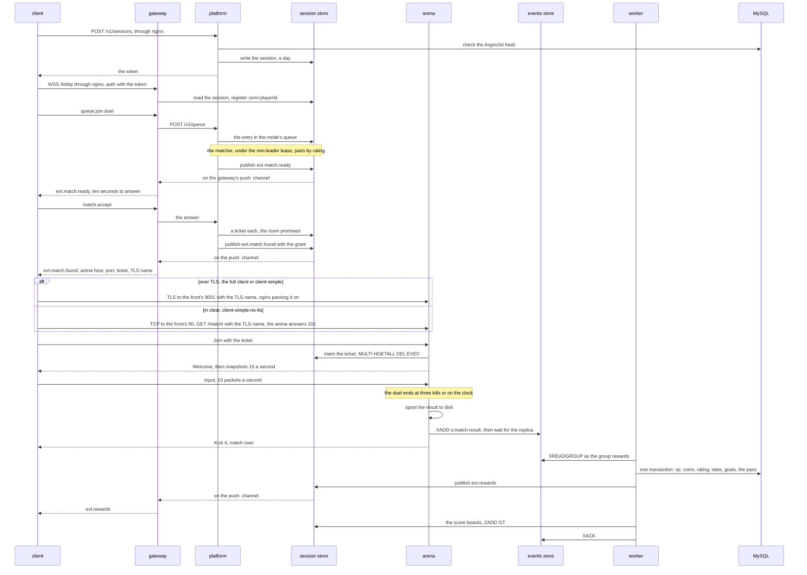
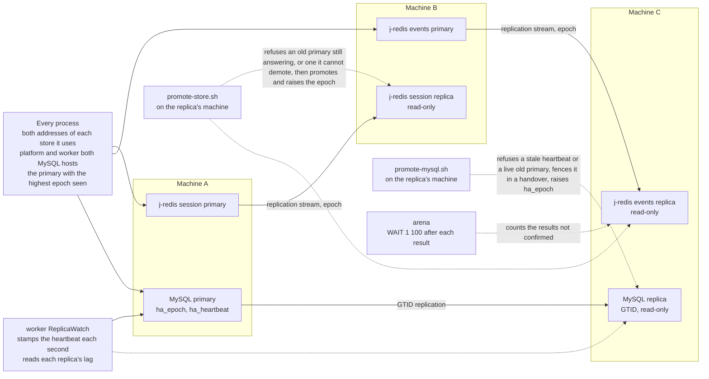
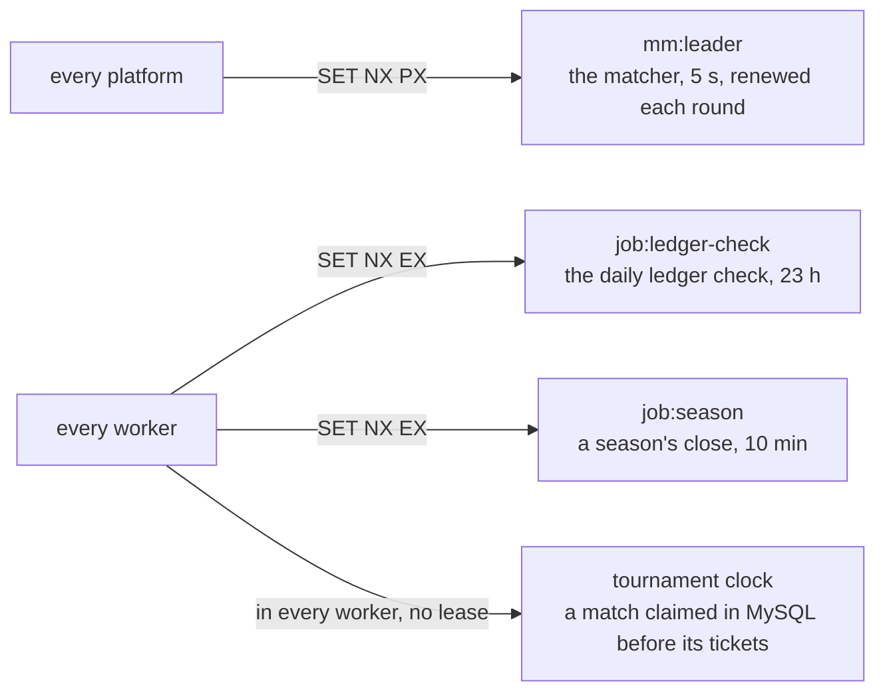

# 01 — The system

This file draws the backend whole, for a reader who wants the big picture first: who uses it, what
runs, what each Maven module depends on, how a match goes from a login to its rewards, and how the
stateful parts fail over. The words are the [glossary](../glossary.md)'s. The reasons are in the
[topology](../architecture/01-system-topology.md), the
[availability model](../architecture/02-availability.md) and the
[decision log](../architecture/03-decision-log.md). The diagrams follow the code as of 2026-10-04,
the site's edge as of 2026-10-19 (D-82), and port 80 as of 2026-11-25 (D-115).

## 1. System context

Who and what the backend meets:

- **A player** uses only the Unity app. The app's engine-free core (`Backend.Client.Core`) does all
  the talking.
- **An operator** reaches the machines by SSH from the internal network, and then uses
  `platform`'s admin API (`AdminServer`) on loopback.
- **The backend's own CA** (certificate authority). The site has one public address, an IP with no
  domain, so no public CA certifies it. Its certificate comes from a CA of the backend's own, whose
  root the app ships ([operations/06](../operations/06-certificates.md)).
- **The payment provider** is simulated (`PaymentService`, D-68).
- **The storage host** for the backups' copy off the site is not chosen yet (Q-53).
- **The alerts' destination**, a webhook that the watch posts alerts to, is not named yet (Q-60,
  D-86). Until it is, alerts are listed by the admin API and written to the journal.

Solid arrows are live connections. Dotted arrows are not: they wait on the owner's choice, are
simulated, or, for the CA, happen by hand, off the servers, when a certificate is issued.

## 2. Containers

Every process and store, what each one speaks, and the ports of the example settings in
`backend/deploy/env/` (every port is a setting).

- Everything a player sends reaches the front's nginx
  ([D-82](../architecture/03-decision-log.md#d-82--one-public-address-for-the-site-nginx-in-front-ending-tls-routing-match-traffic-by-name)).
  nginx ends TLS on 443 and 9001, and takes the same requests in clear on 80 (D-115).
- The API goes on to a platform, and the lobby to a gateway.
- Match traffic goes to the arena that its name gives: on 9001 the TLS name, on 80 the name in
  `GET /match/<name>`. nginx does not read the frames, and match traffic never passes the gateway
  (D-5).
- Pushes and an operator's room commands are published on the `session` store, and reach the
  gateway and the arena by pub/sub.
- Each process also serves its metrics, in the Prometheus text format, on a loopback address
  (`BACKEND_METRICS_ADDR`). The watch in each platform reads them (D-86). Neither is drawn.

The diagram is drawn for three machines. At launch all of it is on one machine, the front, on
loopback ([D-93](../architecture/03-decision-log.md#d-93--the-site-launches-on-one-machine-for-up-to-about-5-000-players),
[07](07-deploy-and-operations.md#the-launchs-one-machine)).

## 3. Maven modules

What each module of `backend/` depends on, read from its `pom.xml`. An arrow points from a module
to what it uses.

- `arena` never reaches MySQL: nothing it depends on brings a database driver. That is why
  `handoff` exists.
- `platform` sees `arena` in its tests only.
- `platform` uses Nimbus JOSE + JWT to check the account service's ES256 tokens (`AccountTokens`, D-117). The
  account service, a project of its own beside `backend/` (`account-service/`), hashes the passwords with Bouncy
  Castle's `bcprov`, as the platform did until D-117. `crypto-examples` uses Bouncy Castle too, and is never in the
  release.

## 4. From a login to the rewards

The main path, for a queued duel. The classes involved:

- the login: `AuthService` and `SessionStore`;
- the lobby: `LobbyHandler` and `ConnectionRegistry`;
- the queue, the confirm step and the tickets: `QueueService`, `MatchQueue` and `Matchmaker`;
- the join: `TicketStore` and `RoomThread`;
- the spool and the stream: `MatchResultPublisher`;
- the result: `MatchResultConsumer` and `MatchResultRepository`;
- every push: `LobbyPush`. Each push goes on the channel of the gateway that holds the player's
  connection, which the key `conn:` names.

The full client and `client-simple` reach the arena over TLS, through the front's 9001.
`client-simple-no-tls` reaches it in clear, through the front's 80 (D-115), shown as the second
branch.

## 5. High availability

### Primaries, replicas and promotion

The three stateful roles, each a primary with a replica on another machine, in the three-machine
layout of the topology. At launch the site is one machine, with no replica, and nothing here fails
over until there is a second machine (D-93, topology §2).

- Promotion is a script that an operator runs (D-8).
- An epoch, a number that only a promotion raises, keeps every process off an old primary.
- Each promotion script refuses to make two primaries (D-95): it refuses an old primary that still
  answers when the operator said it was down, and one it cannot fence when asked to fence it.

The classes and scripts: `StoreClients` and the j-redis client (the stores), `PrimaryDataSource`
(MySQL), `ReplicaWatch` (the heartbeat and the lag), `MatchResultPublisher` (the wait for the
`events` replica), `promote-store.sh` and `promote-mysql.sh`.

### Leases

A job that only one process of many must run is taken by a lease in the `session` store: `SET NX`
with an expiry, given back when done. No lease carries a fencing token, because each job is safe
to repeat (availability §5). The classes are `Matchmaker`, `LedgerCheck` and `SeasonKeeper`. The
tournament clock (`TournamentScheduler`) runs in every worker and needs no lease: it claims a match
in MySQL instead (D-41).

