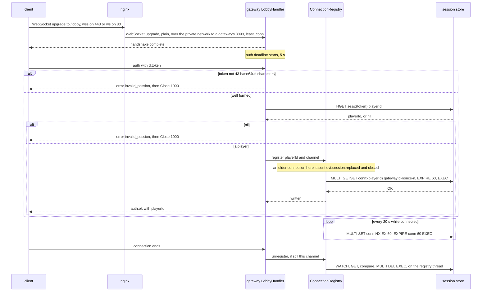
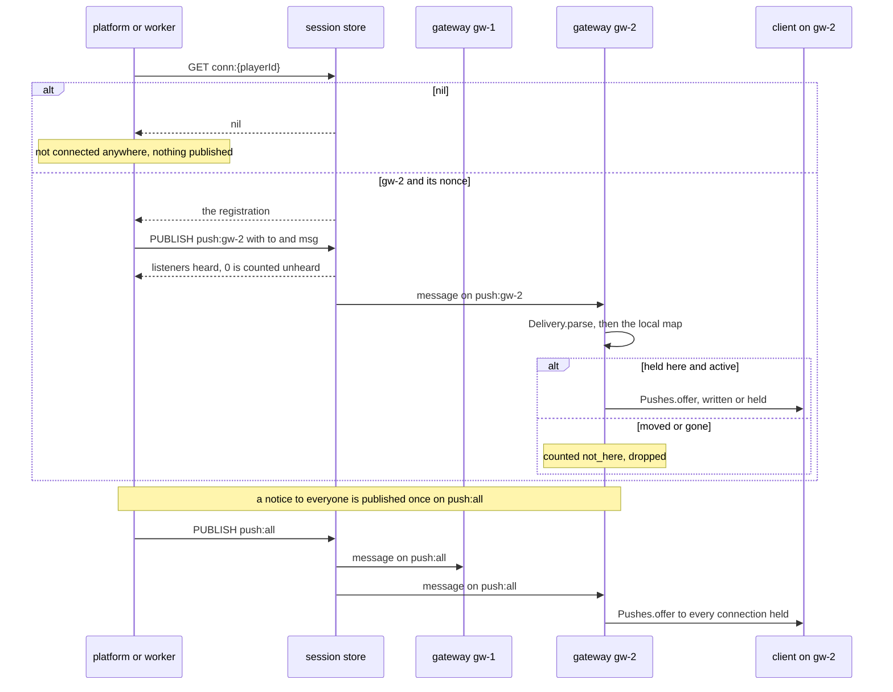
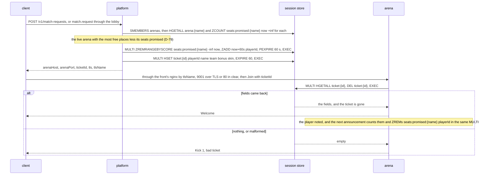
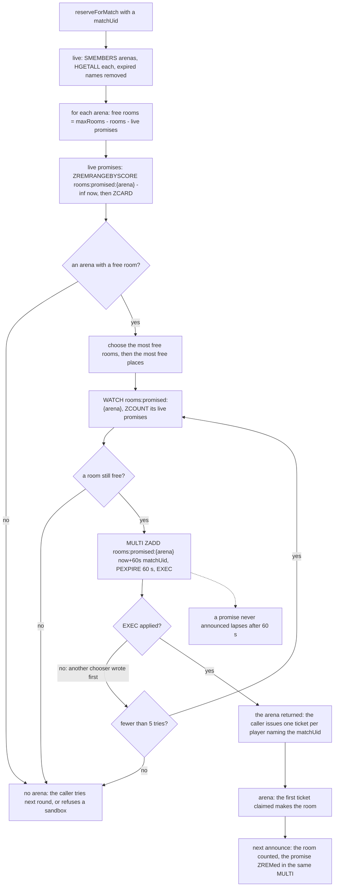
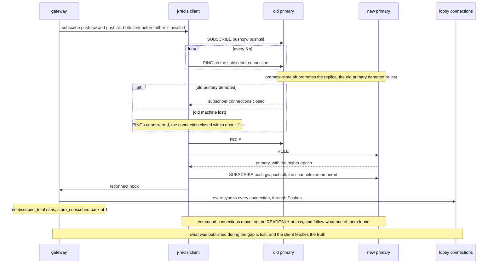
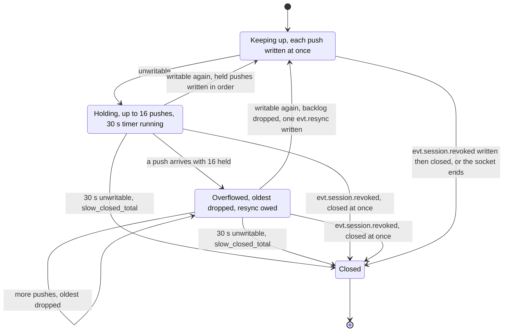
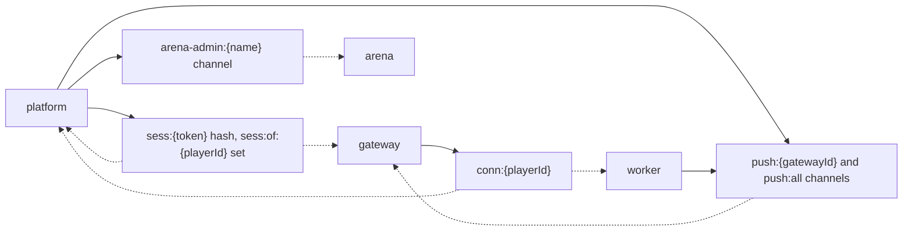
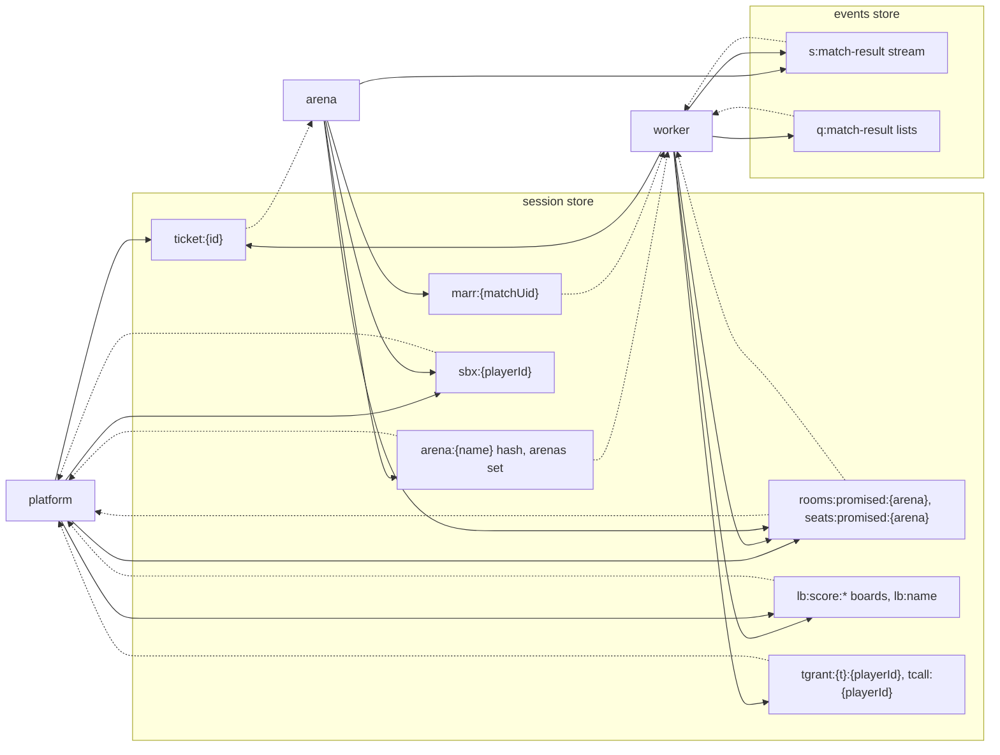

# Diagrams — the lobby and the store

This file shows two things, as built: the flows of the lobby connection, and what the processes
hand each other through the store (j-redis, the backend's own Redis-compatible store). It is for
engineers working on the gateway, the platform or the store's keys. The design is
[03 — Gateway](../detailed-design/03-gateway.md) and
[04 — Platform services](../detailed-design/04-platform-services.md). The references are the
READMEs of [gateway](../../backend/gateway/README.md), [handoff](../../backend/handoff/README.md)
and [common](../../backend/common/README.md).

The *lobby connection* is the WebSocket a client keeps open between matches, on `/lobby`, through
the front's nginx to a gateway. The *session store* and the *events store* are the two j-redis
instances ([glossary](../glossary.md#1-processes-and-places)).

## Lobby connect and auth

Three classes take part ([03 §4](../detailed-design/03-gateway.md#4-connection-lifecycle)):

- `LobbyHandler` takes the WebSocket handshake and the `auth` message;
- `SessionStore.playerIdOf` reads the session;
- `ConnectionRegistry` writes the registration that pushes are routed by.

`auth.ok` waits for that write, so a push sent the moment `auth.ok` arrives still finds the player.
The client reaches nginx over TLS on 443 (`wss://`), or in clear on 80 (`ws://`, D-115); nginx
passes both to a gateway the same way.

The value written is `{gatewayId}#{nonce}-{n}`. The diagram writes the `#` as a dash, because a
Mermaid label cannot carry it.

## Push routing across gateways

A push is a message the backend sends to a player's lobby connection without being asked
([03 §5](../detailed-design/03-gateway.md#5-push-routing)):

1. `LobbyPush.send` looks up the player's registration, and publishes on the channel of the gateway
   named before its `#`.
2. That gateway's subscription (`GatewayServer.listenForPushes`) hands the message to
   `ConnectionRegistry.deliver`.
3. `deliver` passes it to the connection's `Pushes`, on that connection's event loop.

## Ticket issue and claim

A ticket is a single-use key, valid 60 s, that lets one player into one arena
([04 §3](../detailed-design/04-platform-services.md#the-join-ticket)):

- `platform`'s `JoinService` picks an arena from `ArenaDirectory` and issues the ticket with
  `TicketStore.issue`.
- The arena's `MatchFrameHandler` claims it with `TicketStore.claim`, off its event loop.
- A made match's tickets are issued the same way, after a room is reserved (next diagram).

The client dials the front's 9001 over TLS, or its 80 in clear with `GET /match/<tlsName>` (D-115,
[02](02-arena-and-wire.md#join-with-the-ticket-claim-and-the-welcome)); the ticket is the same.

## Room reservation for a made match

`ArenaDirectory.reserveForMatch` promises a room in an arena to a made match. Three callers use it:
`platform`'s matcher (`Matchmaker.make`), `platform`'s sandbox opener (`QueueService`), and
`worker`'s `TournamentScheduler`. An arena announces its rooms only every 3 s. The promise
stops several matches, chosen between two announcements, from all going to an arena's last free
room ([D-42](../architecture/03-decision-log.md#d-42--a-matchs-room-is-promised-in-the-store-when-its-arena-is-chosen)).

## Store failover, the subscriber following the primary

What a gateway does when the session store's primary changes, so that pushes keep reaching it
([03 §5](../detailed-design/03-gateway.md#when-the-subscription-is-lost-designed-2026-10-01-plan-item-50),
[runbook §2](../operations/02-runbook.md#a-j-redis-store-built-2026-09-29-d-34)):

- `StoreClients.open` gives the gateway a j-redis client that knows both addresses of the session
  store, the primary's and the replica's.
- `GatewayServer.listenForPushes` subscribes to both channels, and registers a reconnect hook.
- After a reconnect the hook tells every connection to resynchronise, through
  `ConnectionRegistry.resync`: the client then fetches the truth again.

## Slow-client backpressure

Each connection's `Pushes` holds pushes while Netty reports the connection unwritable, meaning more
than 64 KiB is waiting to go out. After 30 s unwritable, it closes the connection
([03 §8](../detailed-design/03-gateway.md#8-backpressure-and-slow-clients)). Pushes are held in a
ring of 16. Replies to the client's own requests do not pass through the ring.

Each spell from unwritable to writable or closed is timed into
`backend_gateway_unwritable_seconds{end}` (`drained` or `closed`).

## Who writes and reads each key family

A *key family* is a set of store keys with one name pattern, such as `ticket:{id}`. In both
diagrams below, a solid arrow writes or publishes, and a dotted arrow reads or subscribes. The full
table, with each key's type and lifetime, is in
[handoff's README](../../backend/handoff/README.md#store-key-families).

### Sessions, the lobby and the operator's channels

The keys of `SessionStore`, `LobbyPush`, the gateway's `ConnectionRegistry`, and
`ArenaDirectory`'s operator channel. All of them are on the session store.

### Matches and their results

The keys of `TicketStore`, `ArenaDirectory`, `SandboxHolds`, `TournamentGrants`, `MatchArrivals`
and `LeaderboardStore` are on the session store. Those of `MatchResultStream` and
`MatchResultQueue` are on the events store.

Two arrows need a word:

- **`rooms:promised:{arena}`, `seats:promised:{arena}`:** the arena only removes promises, in its
  announcement. Only `platform` promises seats.
- **`s:match-result`:** a worker writes to it only when it moves the old list inbox into it.
