# Diagrams: platform

This file draws the flows of [04 — Platform services](../detailed-design/04-platform-services.md):
accounts, the queue, parties, teams, tournaments, payments, the shop and the admin API. It is for
engineers working on `platform`, or on a client that calls it. The diagrams are drawn from the code
in `backend/platform`, and in `handoff`, `persistence` and `worker` where a flow continues there.
Every route, answer and refusal named here is listed in the
[platform README](../../backend/platform/README.md).

A client calls the API through the front's nginx: over HTTPS on 443, or in clear on 80 (D-115).
nginx passes both to a platform the same way, so the diagrams draw one nginx. Where a diagram has no
nginx, the client's calls still pass it.

## Log in by the account service's token

Since D-117 an account signs up and logs in at the account service, which hashes the password and
signs an access token ([10](../detailed-design/10-accounts.md)); the platform takes that token once
for a session. The classes: `PlatformHttpServer.login`, `AuthService.exchange`, `AccountTokens.access`,
`persistence/AccountRepository.findBySubject`, `erasedSubject` and `createForSubject`, and
`handoff/SessionStore.create`.

- The token is checked by the account service's published keys, kept five minutes: a login asks the
  account service nothing, unless the token names a key the set lacks (10 §4.2).
- Every reason a token is not taken gets the one answer, 401 `invalid_token`; why is logged.
- Before the platform, nginx limits `/v1/sessions` to 2 requests a second for each address, with a
  burst of 30 (429).

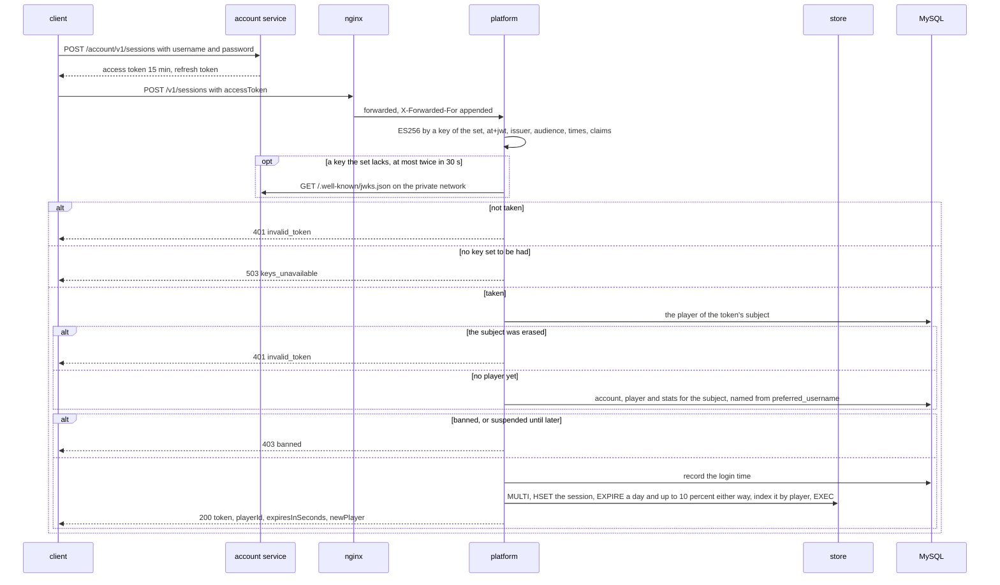

## Guests, and linking an account

A guest is an account made with nothing asked, which the device logs in to with a secret key. The
classes: `AuthService.createGuest`, `loginGuest` and `link`, and
`persistence/AccountRepository.createGuest`, `findGuest` and `link`. A guest's key is never stored,
only its SHA-256, so a guest's login needs no slow hash.

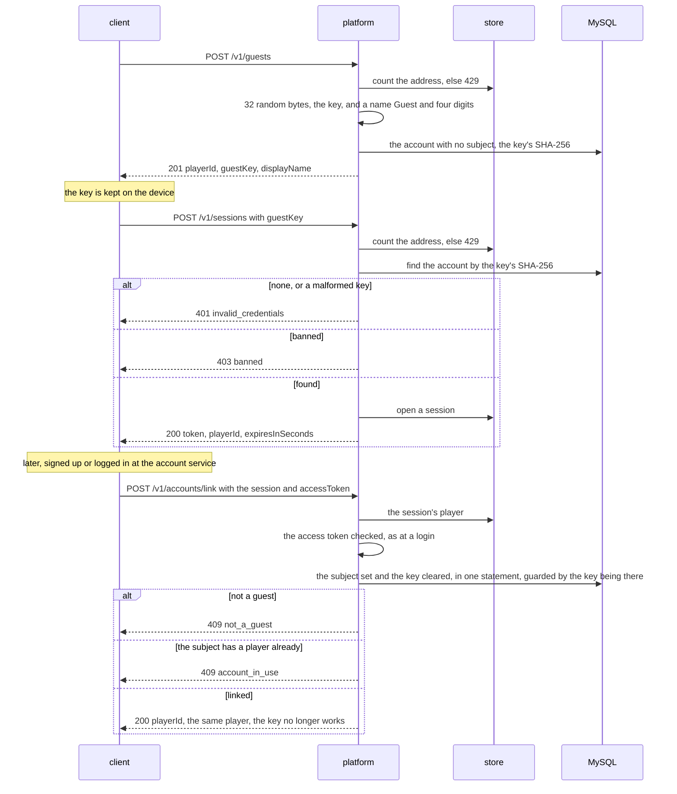

## The account service's events

A password changed or an account deleted at the account service is written to its outbox in the
same transaction, and posted to the platform until taken (10 §3.5). The classes:
`PlatformHttpServer.accountEvents`, `AccountTokens.event`, and
`AccountDeletion.deletedAtTheAccountService` and `sessionsRevokedAtTheAccountService`.

```mermaid
sequenceDiagram
    participant AS as account service
    participant P as platform
    participant S as store
    participant D as MySQL
    AS->>P: POST /v1/account-events, a signed event, application/secevent+jwt, on the private network
    P->>P: ES256, secevent+jwt, issuer, audience, one event it knows
    alt not taken
        P-->>AS: 400 err authentication_failed, retried and logged there
    else deleted
        P->>S: out of the queue and the party
        P->>D: out of the team whatever its role; then erased in one transaction, the subject recorded
        P->>S: off the boards, every session ended, each lobby told deleted
        P-->>AS: 202
    else sessions-revoked
        P->>S: the sessions made before the event ended, those after kept
        opt one ended
            P->>S: the lobby told signed_out, whichever session it was on
        end
        P-->>AS: 202
    end
```

## A seat in the public arena

"Play now" in the public arena, the room every arena runs without end. The classes:
`JoinService.requestJoin`, `EquipmentService.bonusOf` and `skinOf`, `handoff/ArenaDirectory.pick`
and `promiseSeat`, and `TicketStore`. The arena claims the ticket in `MatchFrameHandler`. The ticket
carries everything the arena needs, so the arena never reads MySQL. The client reaches the arena
through the front: 9001 over TLS, or 80 in clear with `GET /match/<tlsName>` (D-115,
[02](02-arena-and-wire.md#join-with-the-ticket-claim-and-the-welcome)).

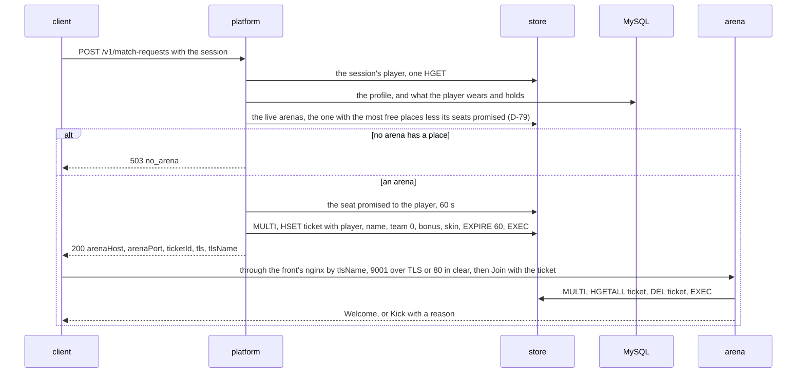

## The queue and the confirm step: a player's record

`MatchQueue` keeps one record for each player, `mmp:{playerId}`. It says whether the player is
queued, asked to confirm, or matched. Each move between states is one watched transaction (D-55).
The record expires, so a player stuck by a crash returns to `none` by themselves.

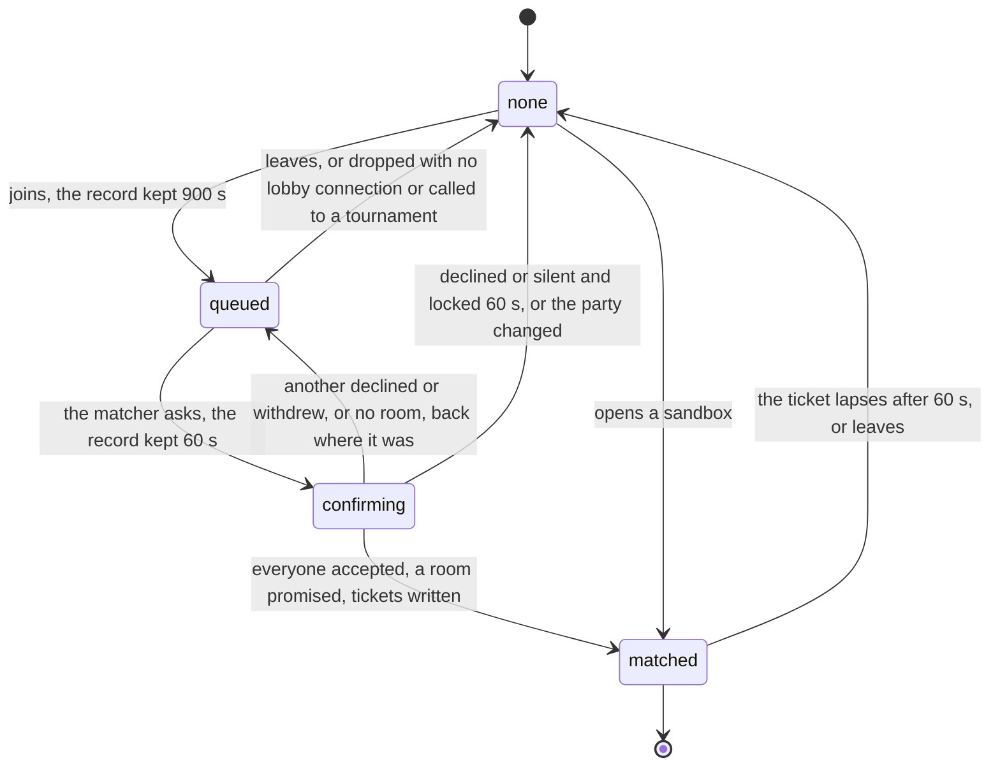

## The queue and the confirm step: a round

The classes: `QueueService.join` and `answer`; `Matchmaker.round`, `settle`, `match`, `lineups`,
`make` and `callOff`; and `MatchQueue.join`, `ask`, `answer`, `make` and `end`. Only the platform
that holds the lease `mm:leader` runs the round. A step that another write has overtaken writes
nothing, and the next round reads again.

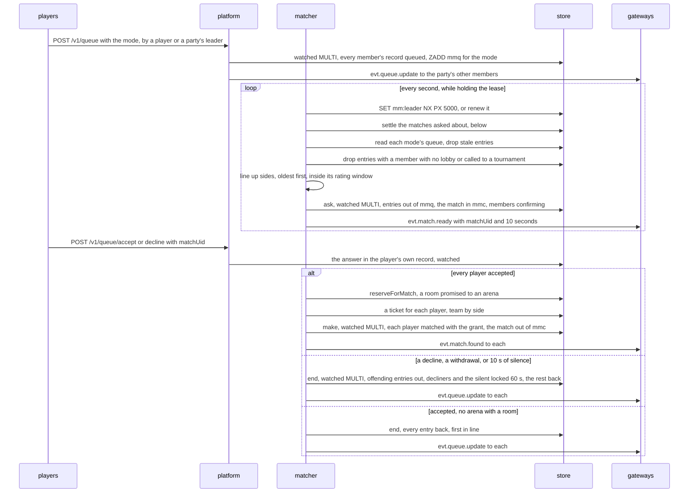

## A party, its versions

A party is up to three players who queue together. The classes are `PartyService` and `Parties`;
the client keeps the newest state with `PartyState` (D-74).

- Each change reads what it depends on under a watch, and writes in one transaction, which raises
  the party's version by one.
- An answer and a push can arrive in either order. The client applies a state only if it names
  another party, or has a higher version.

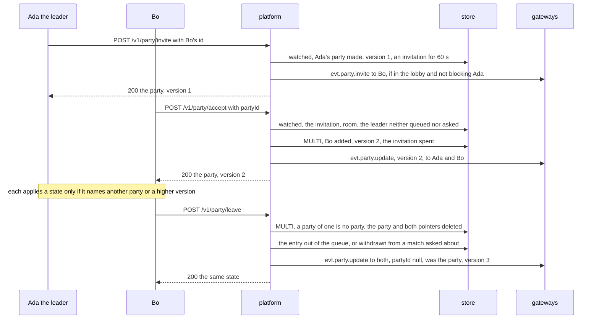

## A team action

A team is a lasting group of players, kept in MySQL. The classes are `TeamService` and
`persistence/TeamRepository`. Each action is one MySQL transaction, which locks the team first and
then the players it changes (D-39). The pushes are sent after the commit. A refusal tells nobody.

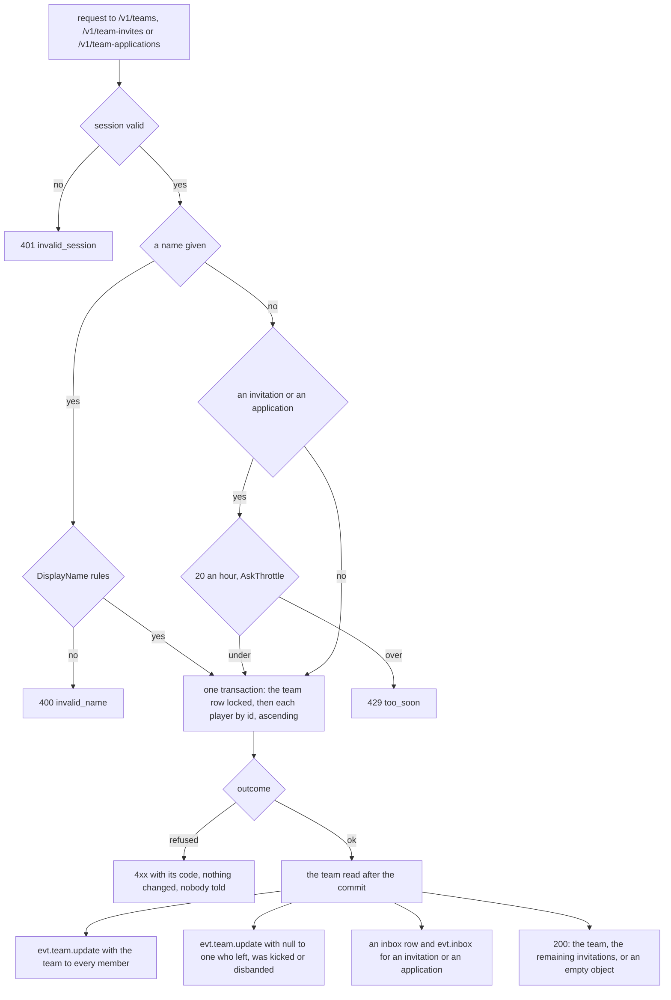

## A tournament

`persistence/TournamentRepository` holds a tournament's state, and `worker/TournamentScheduler`
moves it on every 5 s. Each move is a conditional update on the state and the version, so two
workers cannot make the same move twice. An operator creates a tournament with
`POST /admin/tournaments`, and players enter while it is in `registration`.

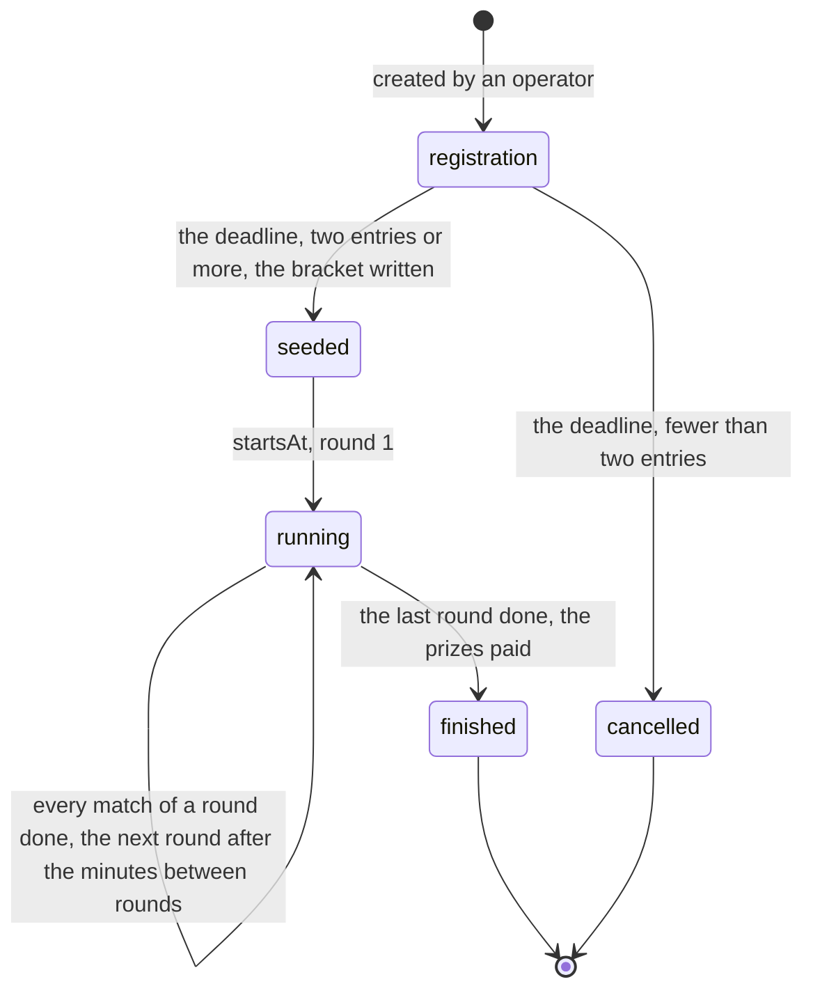

## A tournament match

One match of the bracket, in `TournamentScheduler.make` and `settle`. A match nobody came to is
decided 270 s after its tickets. A match somebody came to waits for its result for up to 30
minutes; the arena marks the first arrival in `marr:{matchUid}`.

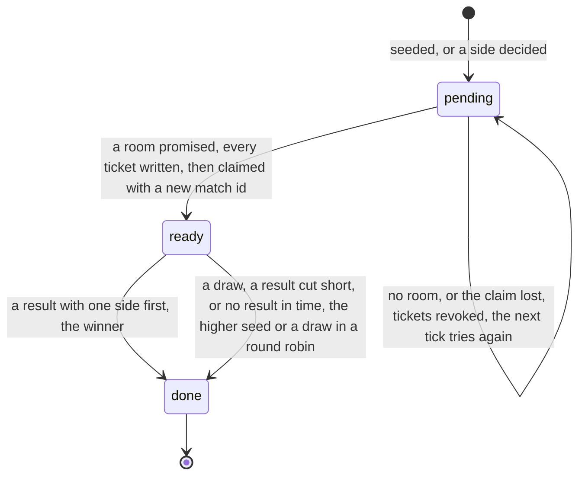

## The scheduler's round

The methods: `TournamentScheduler.tick`, `step`, `run`, `make`, `settle` and `over`. A player's grant
is kept for the ticket's 60 s (`tgrant:`), and the player is marked as called (`tcall:`), which the
queue treats as being in a match.

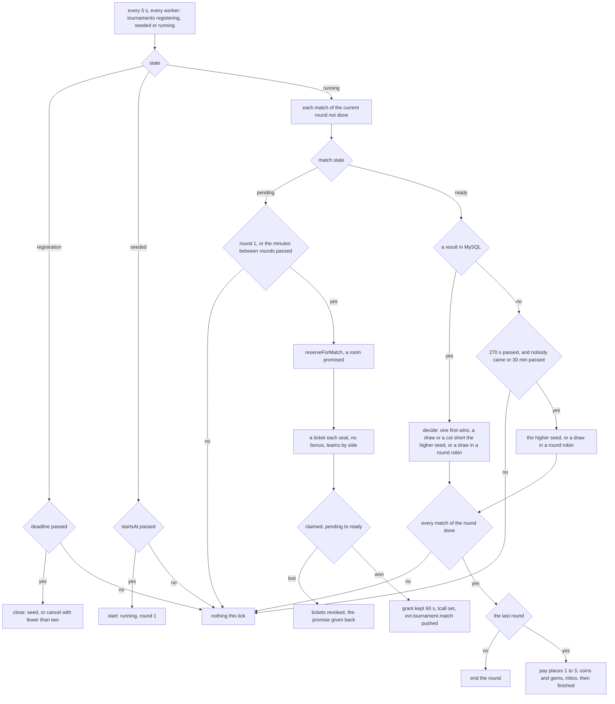

## A simulated payment order: its states

An order is a player's request to buy a pack of gems; the payment provider is simulated (D-68). In
`persistence/PaymentRepository` an order moves only forward, each step under its row's lock.
`worker`'s retention marks an order expired once it has waited a day.

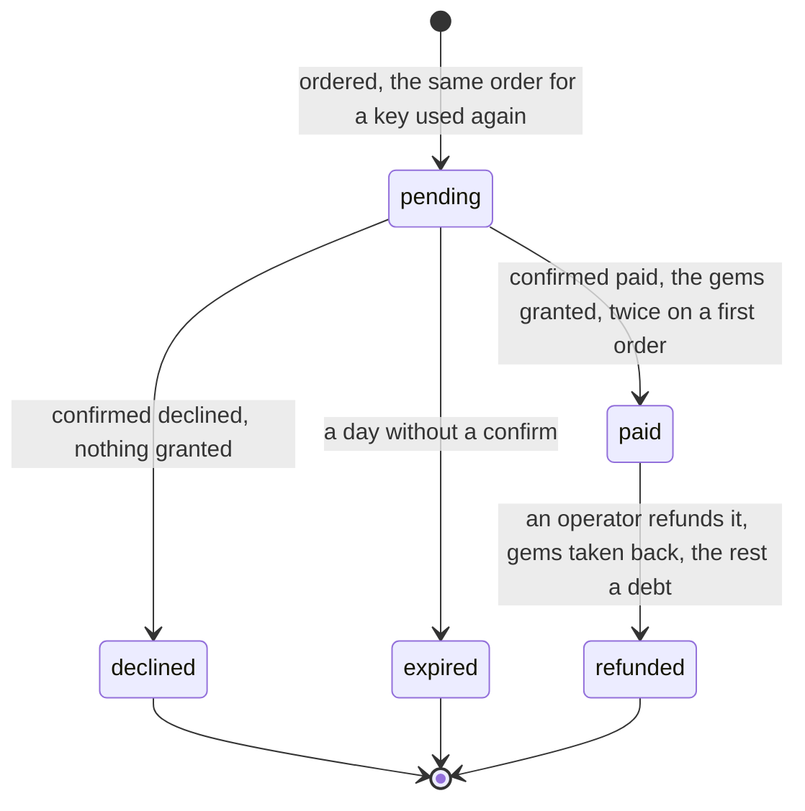

## A simulated payment order: the calls

`PaymentService`, `persistence/PaymentRepository` and `AdminRepository.refund` and `clearDebt`.
Every payment route answers 503 `payments_off` unless `BACKEND_PAYMENT_PROVIDER=simulated`.

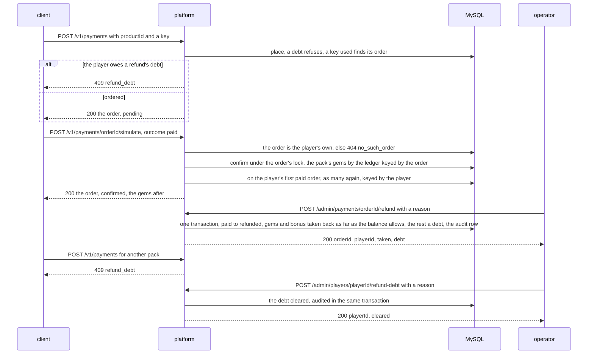

## The season pass crossing tiers

The classes: `persistence/SeasonPassRepository.earn`, `pay` and `buyPremium`, and the table in
`SeasonPass`. Points are earned in `worker`'s result transaction; premium is bought through
`platform`. Each track (free and premium) has a mark, the last tier it paid. The mark moves with
what it paid, so each tier pays once.

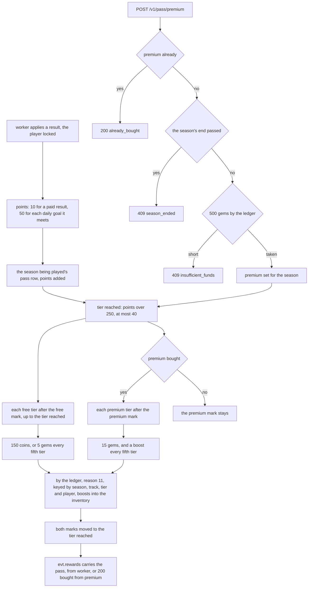

## Buying, wearing and boosting

The classes: `ShopService.buy`, `EquipmentService.wear` and `bonusOf`, and `BoostService.activate`,
with `persistence/EconomyRepository`, `EquipmentRepository` and `BoostRepository`. Each key is made
by the client, once for each tap, and sent again with every retry of that tap. So a retry gets the
same answer as the first attempt.

```mermaid
flowchart TD
    subgraph buy ["POST /v1/purchases"]
        B1["sku and key"] --> B2{"key 16 to 48 of a-z, 0-9 and hyphen"}
        B2 -->|no| B3["400 invalid_key"]
        B2 -->|yes| B4{"key used before"}
        B4 -->|yes| B5["200 already_bought, what it bought"]
        B4 -->|no| B6{"offer known and on sale"}
        B6 -->|no| B7["404 unknown_sku or 409 not_available"]
        B6 -->|yes| B8{"account level high enough"}
        B8 -->|no| B9["403 level_required"]
        B8 -->|yes| B10{"one transaction, the player locked, coins or gems by the ledger"}
        B10 -->|short| B11["409 insufficient_funds"]
        B10 -->|done| B12["200 bought, the balance and how many held"]
    end
    subgraph wear ["PUT /v1/equipment/slot"]
        W1["itemId"] --> W2{"slot and item known, the item for that slot"}
        W2 -->|no| W3["400 invalid_slot, 404 unknown_item or 409 wrong_slot"]
        W2 -->|yes| W4{"held"}
        W4 -->|no| W5["409 not_owned"]
        W4 -->|yes| W6["worn, 200 the loadout, the bonus capped at 25 a stat"]
        W6 --> W7["the next ticket carries the bonus and the skin"]
    end
    subgraph boost ["POST /v1/boosts"]
        X1["itemId and key"] --> X2{"key valid, item a boost"}
        X2 -->|no| X3["400 invalid_key or 404 unknown_item"]
        X2 -->|yes| X4{"one held, no other of its kind running"}
        X4 -->|no| X5["409 not_owned or other_running"]
        X4 -->|yes| X6["one taken, it runs, or the same item's minutes added, 200 activated"]
        X6 --> X7["worker raises a match's xp or coins if it ended while the boost ran"]
    end
```

## An operator's ban, kick and notice

The admin API listens on loopback; an operator reaches it over SSH. The classes:
`net/AdminServer.player`, `kickEverywhere` and `notice`; `persistence/AdminRepository`; and
`handoff/SessionStore.revokeAll`, `LobbyPush` and `ArenaDirectory.command`. Every call is checked
against the secret token and audited, refusals included.

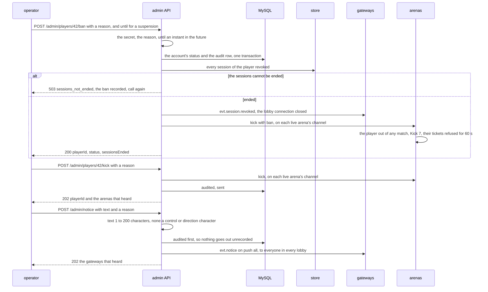
