# 06 — Client diagrams

This file draws the full client: its engine-free core and its Unity layer, from the code in
[`client/`](../../client/README.md). Its last section also places the two simple clients,
[`client-simple/`](../../client-simple/README.md) and
[`client-simple-no-tls/`](../../client-simple-no-tls/README.md). It is for engineers who work on a
client, or who need to know what the client expects of the backend.

The client is written for Unity 2019.4 and Visual Studio 2019 first: the core is C# 7.3 on
.NET Standard 2.0, and it checks the backend's certificate itself, against the backend's own RSA
root (D-108, D-109). The design is [08-client](../detailed-design/08-client.md). The protocol the core
speaks to an arena is [02-networking](../detailed-design/02-networking.md); the lobby's is
[03-gateway §3](../detailed-design/03-gateway.md#3-lobby-protocol).

## 1. The core's structure

The core's public types, in four groups. Every one is in the namespace `Backend.Client.Core`
([client/Core/README.md](../../client/Core/README.md)). Only the members that explain the shape are
shown.

### 1.1 The wire and the world

`Wire.cs`, `WireReader.cs`, `Snapshot.cs`, `Messages.cs`, `ClientWorld.cs` and `Maze.cs`. The
decoder streams a frame into a sink. `ClientWorld` is the sink the connection uses, and keeps the
256 handles (one-byte aliases for entities) from one frame to the next.

```mermaid
classDiagram
    class Wire {
        +int Version
        +int SelfHandle
        +float PosScale
        +int TickHz
        +AimToRadians(aim) float
        +QuantiseAim(radians) int
        +SeqNewer(a, b) bool
    }
    class WireReader {
        +U8() int
        +U16() int
        +Varint() long
        +SVarint() long
        +Str() string
    }
    class SnapshotDecoder {
        +Decode(frame, sink)
    }
    class ISnapshotSink {
        +Header(tickDelta, inputSeqDelta, originDx, originDy)
        +Remove(handle)
        +CreateTank()
        +CreatePredicted()
        +CreateStatic()
        +CreateUnit()
        +Update(update)
        +Event(type, payload)
    }
    class ClientWorld {
        +long ServerTick
        +int LastProcessedInputSeq
        +bool SelfCreated
        +Apply(frame) long
        +EventAt(i) MatchEvent
        +ExpirePredicted()
    }
    class Entity {
        +int Kind
        +int X
        +int Y
        +int Angle
        +PredictedAt(tick, x, y)
    }
    class MatchEvent {
        +int Type
        +string Killer
        +string Victim
    }
    class SelfMotion {
        +bool HasRule
        +float Accel
        +float Radius
        +int InputTicks
    }
    class Removal {
        +int Handle
        +int X
        +int Y
    }
    class Maze {
        +Walls(seed)
    }
    class Wall {
        +Hits(x, y, r) bool
    }
    class ServerMessages {
        +ReadWelcome(frame) Welcome
        +ReadPong(frame) Pong
        +ReadKick(frame) int
    }
    class ClientMessages {
        +Join(ticketId, profile)
        +Resume(secret, profile)
        +Input(seq, ackTick, move, aim, flags)
        +Ping(clientTimeMs)
        +Leave()
    }
    class FrameReader {
        +Feed(bytes, onFrame)
    }
    class ProtocolException
    SnapshotDecoder ..> ISnapshotSink : streams into
    SnapshotDecoder ..> WireReader : reads with
    SnapshotDecoder ..> ProtocolException : throws
    ClientWorld ..|> ISnapshotSink
    ClientWorld "1" *-- "256" Entity : handles
    ClientWorld *-- SelfMotion : Motion
    ClientWorld *-- MatchEvent : the last frame's events
    ClientWorld *-- Removal : the last frame's removals
    ClientWorld *-- Wall : a maze's walls
    Maze ..> Wall : makes from the seed
    ServerMessages ..> WireReader : reads with
```

### 1.2 The match connection and the own tank

`MatchConnection.cs`, `OwnTank.cs` and `TankMotion.cs`. A connection makes a new `ClientWorld` with
every `Welcome`, and keeps one `OwnTank`, stepped by the room's own movement rule. `MatchSettings`
says where to dial and how: the grant's host, port, `Tls` and `TlsName`, and the `TrustRoot` that
the arena's certificate must chain to (1.3).

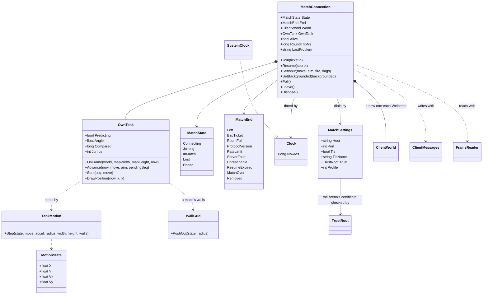

### 1.3 The lobby, the API and the account

`LobbyClient.cs`, `PartyState.cs`, `ApiClient.cs`, `AccountKeeper.cs`, `Json.cs` and `TrustRoot.cs`.

- The lobby client keeps what the lobby told it.
- The API client answers each call with an `ApiResult`.
- The account keeper signs in with the guest key that a secure store keeps.
- `TrustRoot` is the backend's root certificate, which the app ships. It accepts a server's
  certificate when the root issued it and it names the host dialled, and checks this itself on
  every runtime (D-108). It gives the API client its HTTP handler (`HttpHandler`, over
  `HttpWebRequest`), and the lobby's WebSocket and the match connection their check (`CheckFor`).
  Without a `TrustRoot`, the runtime's own check is used.

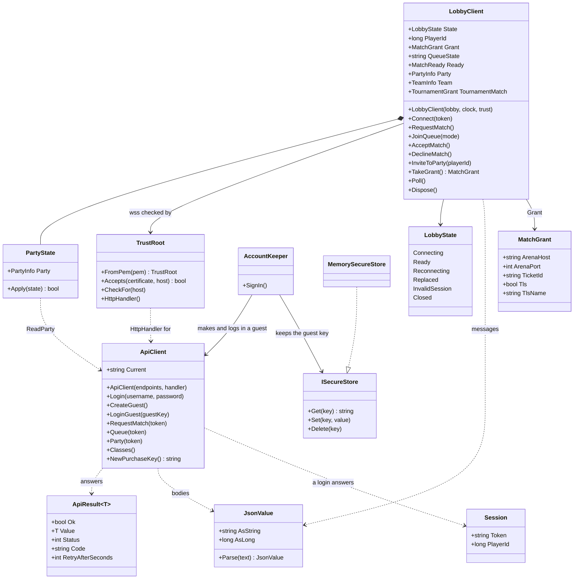

### 1.4 What a frame draws, and the sticks

`Scene.cs` and `TouchSticks.cs`. The layer above passes the render clock's tick
and the own tank's drawn position to `Scene.Build`; the sticks become the
arguments of `MatchConnection.SetInput`.

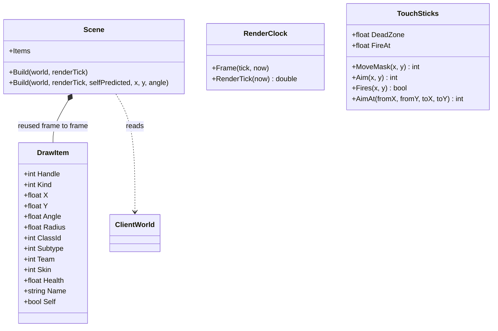

## 2. MatchConnection's lifecycle

`MatchConnection.Poll` moves the state; the receive thread only connects,
reads and queues ([08 §3](../detailed-design/08-client.md#3-the-match-connection)).
`End` says why it ended, and what follows is the layer above's.

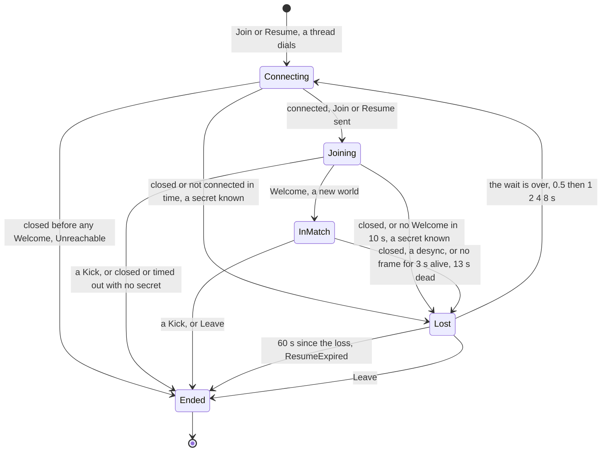

## 3. LobbyClient's lifecycle

`LobbyClient.Poll` moves the state; a reading task and a writing task serve the
socket ([08 §5](../detailed-design/08-client.md#5-the-lobby-and-the-api)). The
wait before each reconnect starts at 1 s, doubles to 30 s at most, is jittered
±50 %, and goes back to 1 s on `auth.ok`.

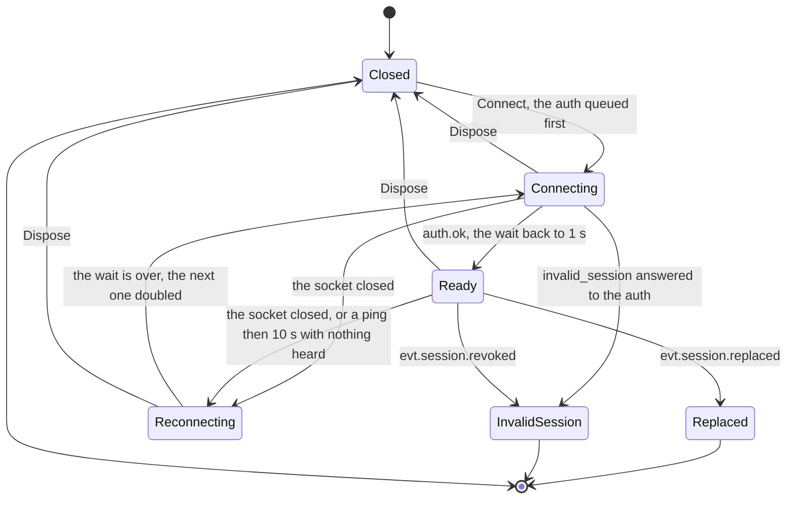

## 4. Join and resume, from the client's side

`MatchConnection` and its receive thread against an arena
([02 §10](../detailed-design/02-networking.md#10-session-reconnect-and-app-lifecycle)): a join, the
frames and inputs of a match, a lost connection resumed, and a `Leave` that waits for the arena to
close the connection first. On the site the grant asks for TLS, so the full client dials the
front's 9001, sends the grant's `TlsName` in its handshake, and checks the certificate with its
`TrustRoot`. A grant without TLS, from a backend run plain on a development machine (D-101), is
dialled in clear. The front's nginx, and the arena's side of the join, are drawn in
[02](02-arena-and-wire.md#join-with-the-ticket-claim-and-the-welcome).

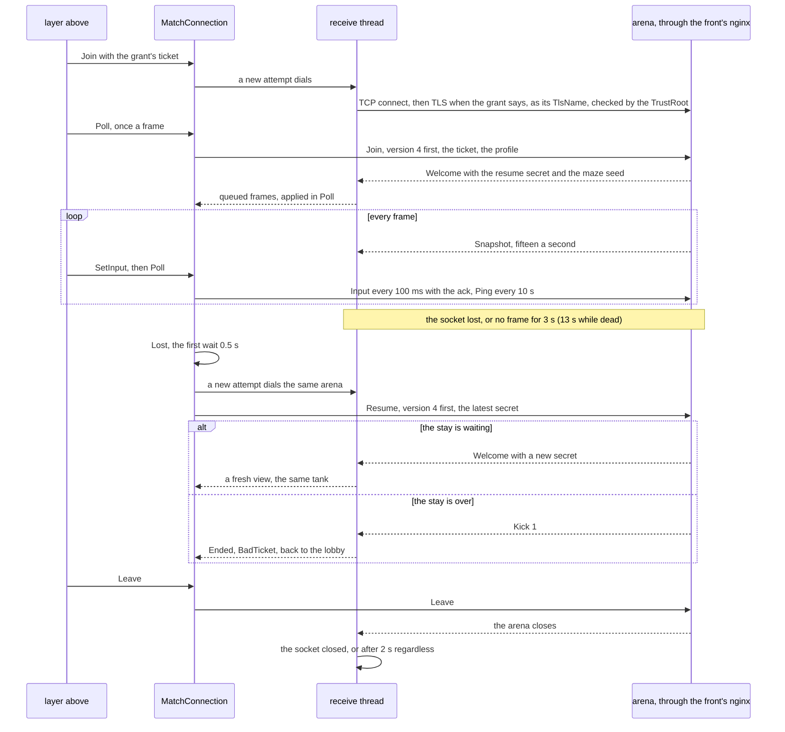

## 5. The own tank: prediction and reconciliation

`OwnTank`, stepped from `MatchConnection.Poll` and reconciled with each frame
([08 §4](../detailed-design/08-client.md#4-the-world-and-when-things-are-drawn),
D-62). `TankMotion.Step` is each step.

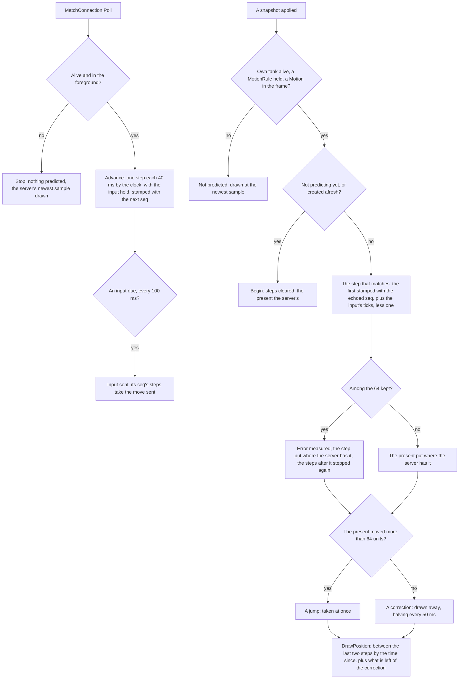

## 6. The render clock and the scene

`RenderClock` and `Scene`, called by the layer above once a frame
([08 §8](../detailed-design/08-client.md#8-the-unity-layer-as-scripts-designed-2026-10-04-plan-item-77)):
everything but the own tank is drawn a little in the past, between samples the
world already has.

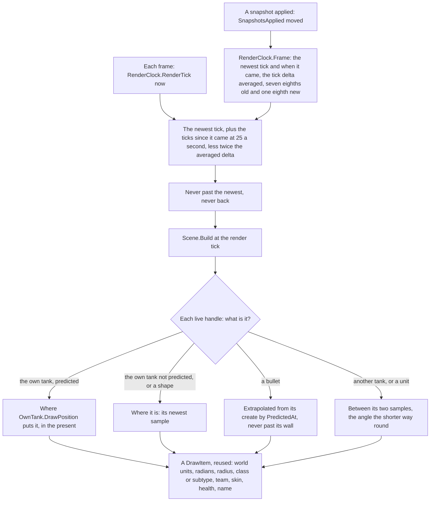

## 7. AccountKeeper's sign-in

`AccountKeeper.SignIn` over `ApiClient` and an `ISecureStore`
([08 §8](../detailed-design/08-client.md#8-the-unity-layer-as-scripts-designed-2026-10-04-plan-item-77)).
Its continuations stay on the caller's context, so in Unity the store is
touched on the main thread.

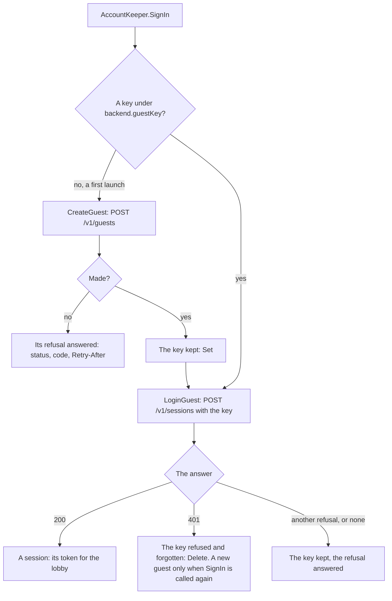

## 8. PartyState's rule

`PartyState.Apply`, called by `LobbyClient` for each party answer and each
`evt.party.update` (D-74): answers and pushes come by different paths, so a
state can arrive after a newer one.

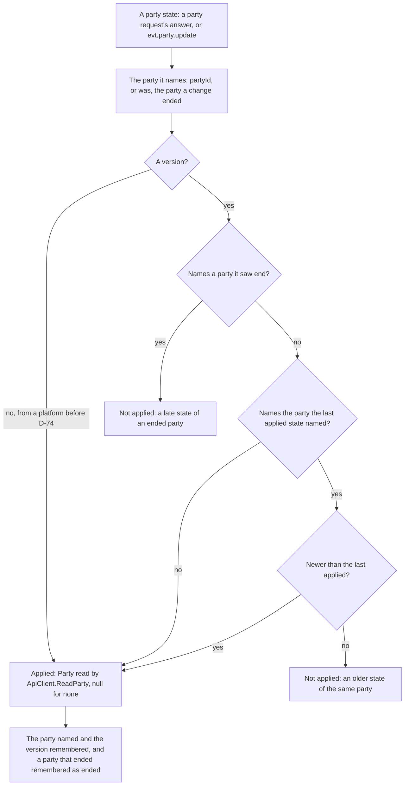

## 9. The Unity layer's wiring

The Unity package's scripts over the core
([client/Unity/com.backend.client](../../client/Unity/com.backend.client/README.md)).
`BackendClient` owns the core's objects and pumps them in `Update`; the other scripts read what it
built, or feed it.

- **Its settings**: the API's endpoints, the lobby's URL, and the backend's root certificate
  (`trustedRoot`, the `ca.pem` that `scripts/private-ca.sh` makes). It dials what the settings give:
  `https://` and `wss://` with a root for TLS, or `http://` and `ws://` in clear. No build refuses a
  way in clear since D-115.
- **Where the guest key is kept**: the Android keystore on a phone; `PlayerPrefs` in the editor and
  other builds. The iOS keychain plugin stays in the package, unused, since iOS is not a target
  (C-10).

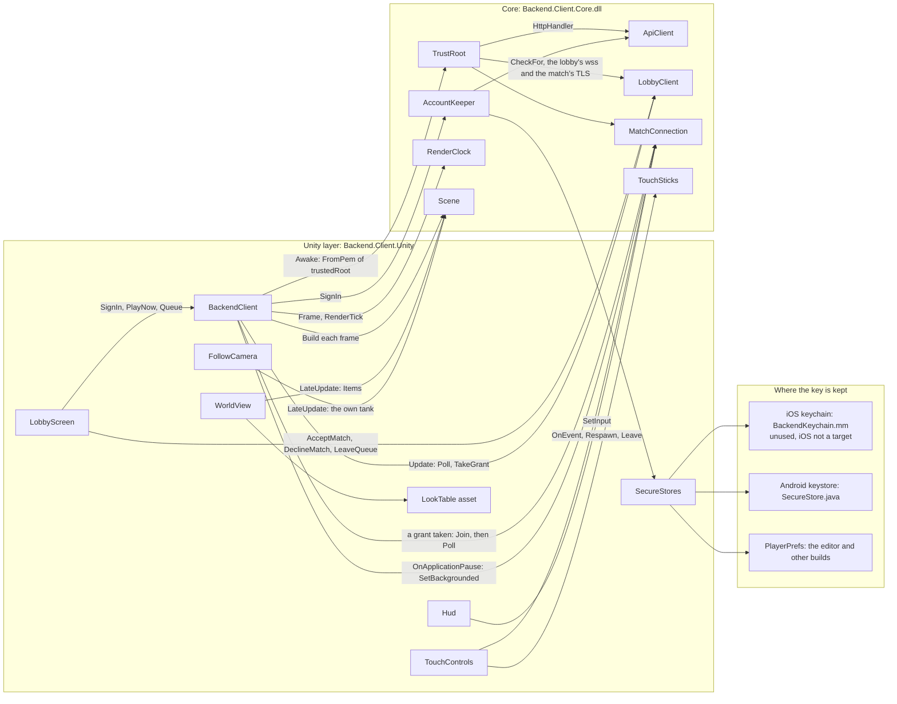

## 10. The three client trees and their ways in

The repository has three clients, and one protocol: a change to the protocol is made in all three
(D-111 to D-115).

- **`client/`**, the full client: the core above and its Unity layer, with prediction, the world and
  drawing.
- **[`client-simple/`](../../client-simple/README.md)**, for the UI team, in small files they can
  read and copy (D-111, D-112). It has three parts. The API is `BackendHttp`, over `HttpClient`; it
  sets the backend's root as the app's certificate check, through `ServicePointManager`. The lobby
  is `LobbyClient`, over a WebSocket of its own. A match is `ArenaClient`.
- **[`client-simple-no-tls/`](../../client-simple-no-tls/README.md)**, the same without TLS and without
  a certificate (D-114). On the site its grant asks for TLS and names the arena, so it reaches the
  arena through 80 by that name: `ArenaClient.ConnectThroughSite` sends `GET /match/<tlsName>` with
  `Upgrade: backend-match`, and the match's frames follow the `101` (D-115). A grant without TLS, from
  a backend run plain, it dials straight (`Connect`).

The diagram shows which of the front's ports each client uses on the site. For the full client and
`client-simple`, a solid arrow is the way over TLS, and a dotted arrow is the way in clear, taken
when their settings give `http://` and `ws://`. Both keep 9001 for matches either way.
`client-simple-no-tls` has only the ways in clear, all on 80.

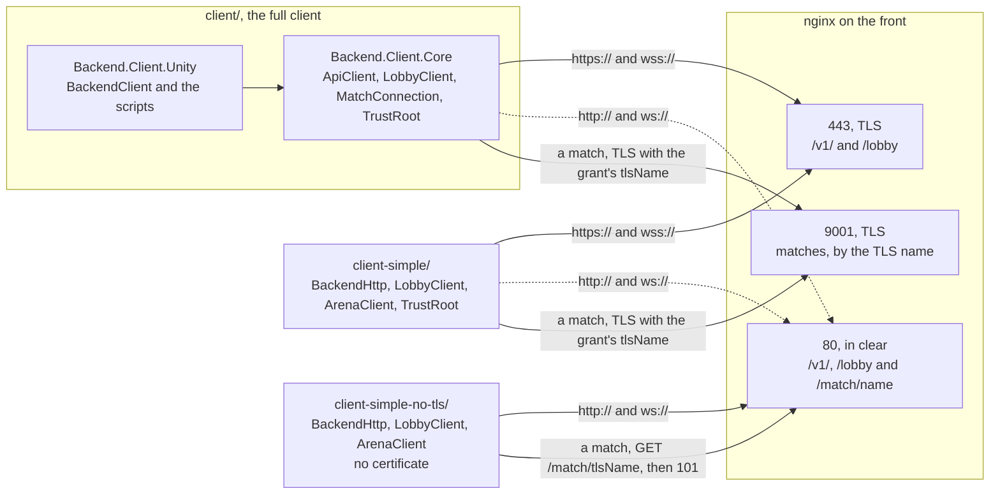
