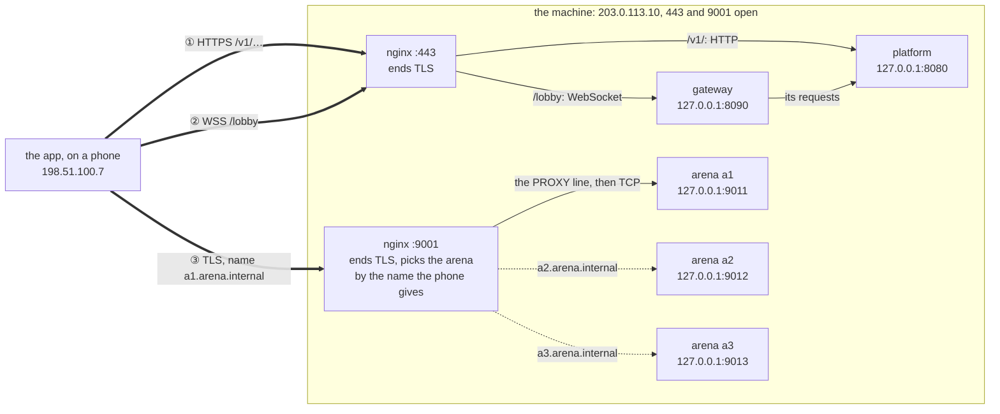
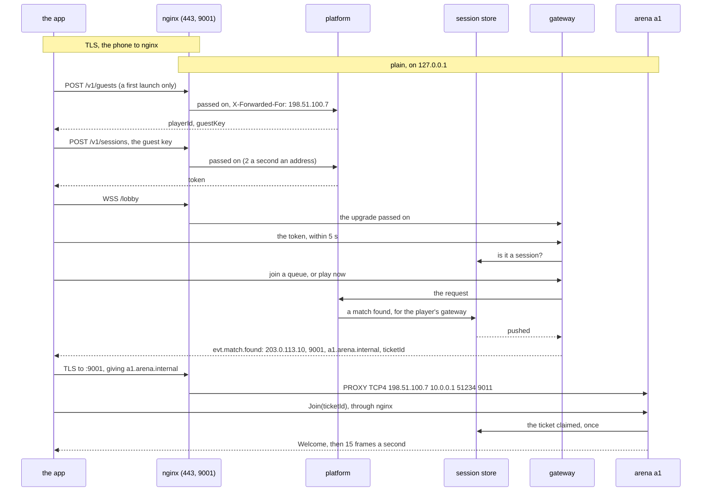
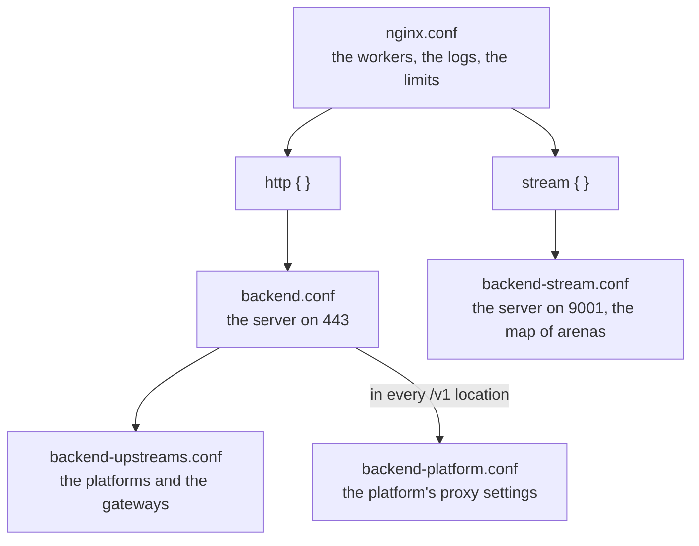

# Phone-to-backend routes

Every connection the Android app opens to the backend, from the phone to the process that answers it, on the site
and on a development machine; and nginx's part in full: each of its files, each setting in them and why, how the
install guide and the development scripts change them, its logs, and how it is run and checked. The ports and the
firewall are [05](05-ports-and-firewall.md)'s, the certificate [06](06-certificates.md)'s; this page draws the
routes through both.

The addresses are the examples', as in 05: the site's public address `203.0.113.10`, a phone at `198.51.100.7`. The
layout is the launch's one machine ([D-93](../architecture/03-decision-log.md#d-93--the-site-launches-on-one-machine-for-up-to-about-5-000-players)): every process on it, nginx alone reachable from outside.

## 1. The three routes

The app opens three connections, all to the site's one public address, and every one goes through nginx, which
ends their TLS ([D-82](../architecture/03-decision-log.md#d-82--one-public-address-for-the-site-nginx-in-front-ending-tls-routing-match-traffic-by-name)):



The thick arrows are TLS, from the phone to nginx; the thin ones are plain, behind nginx on `127.0.0.1`, where every
process but nginx listens. An arrow is who opens the connection; the answers come back on it.

| Route | The app dials | It checks the certificate for | nginx | Then |
|---|---|---|---|---|
| ① the API | `https://203.0.113.10/v1/…` | the address | `backend.conf`: `/v1/` to the platform, anything else 404 | the platform |
| ② the lobby | `wss://203.0.113.10/lobby` | the address | `location = /lobby`: the WebSocket's upgrade passed on | the gateway with the fewest connections, which sends the lobby's requests to the platform |
| ③ a match | TCP to `203.0.113.10:9001`, TLS giving the grant's `tlsName` | `tlsName`, `a1.arena.internal` | `backend-stream.conf`: the arena that name maps to, after the PROXY line; no name or an unknown one, closed | the arena, with a ticket that works once |

Nothing else on the machine is reachable from the internet: 80 has nothing listening and the firewall closes it, and
every other process is bound to `127.0.0.1` ([03 §6 to §8](03-install-guide.md)).

## 2. One session, in order



Every message from the app crosses nginx; the diagram draws the hop only where nginx adds something. A device's
later launches skip the guest and log in with the key it keeps (`AccountKeeper`). A match found arrives on the lobby,
or answers `GET /v1/queue` or `POST /v1/match-requests`: `arenaHost` the site's address, `arenaPort` 9001, `tls`
true, the arena's `tlsName`, and a `ticketId`.

## 3. Limits and timeouts

nginx always waits longer than the process behind it, so the process decides when a connection is dead, and says
why in its own log and metrics.

| Route | The app | nginx | The process behind |
|---|---|---|---|
| ① the API | gives up after 10 s | 15 s for an answer; a body up to 4 KiB; the four sign-up and login paths 2 a second an address, 30 at once, then 429 | the platform: a body up to 4 KiB; password attempts limited precisely, nginx's limit only a flood guard in front |
| ② the lobby | a ping every 30 s, lost with no answer in 10 s; reconnects after 1 s, doubling to 30 s | closes after 150 s without a byte | the gateway: the token within 5 s; closes a lobby silent for 120 s |
| ③ a match | 5 s to dial; a ping every 10 s in every state | 5 s to reach the arena; closes after 60 s without a byte | the arena: `Join` within 10 s; drops a connection after 30 s without a frame |

## 4. nginx, file by file

The release's nginx (`/opt/backend/nginx`, 1.30.5, OpenSSL 3.5.9 compiled in, built for glibc 2.28,
[D-100](../architecture/03-decision-log.md#d-100--the-releases-nginx-is-built-on-rocky-8-glibc-228-the-floor-mysql-already-sets)) reads five files, which the release ships in `nginx-conf/`
and the install copies to `/etc/backend/nginx/`. They include each other so:



The same files go on every machine, so any can be the front; only the addresses in `backend-upstreams.conf` and the
map, and the address in `server_name`, are the site's own (§4.7).

### 4.1 `nginx.conf`, the main file

| Setting | Value | Why |
|---|---|---|
| `user` | `nginx` | The workers run as `nginx`; the master, started as root by the unit, binds 443 and 9001 and reads the key |
| `worker_processes` | `auto` | One worker a core |
| `worker_rlimit_nofile` | `262144` | Every connection holds two descriptors, the phone's and the upstream's, and the front holds every player's: a lobby and a match connection each, 200 000 at 50 000 players. The unit's `LimitNOFILE` matches |
| `pid` | `/run/backend-nginx/nginx.pid` | In the unit's `RuntimeDirectory` |
| `error_log` | `/var/log/backend-nginx/error.log warn` | In the unit's `LogsDirectory` |
| `events { worker_connections }` | `16384` | Per worker, a worker a core: each connection two descriptors, inside each worker's 262 144 |
| `http { include mime.types; default_type }` | the release's `mime.types`, `application/octet-stream` | nginx's defaults; nothing here serves a file |
| `log_format backend` | `$remote_addr [$time_local] "$request" $status $body_bytes_sent $request_time $upstream_addr "$http_user_agent"` | `$upstream_addr` says which machine served each request, behind the front |
| `access_log` | `/var/log/backend-nginx/access.log backend` | |
| `sendfile`, `tcp_nopush` | `on`, `on` | nginx's usual pair |
| `keepalive_timeout` | `65s` | How long a phone's idle HTTPS connection is kept for its next call |
| `include` | `backend.conf` in `http`, `backend-stream.conf` in `stream` | The two servers |

### 4.2 `backend.conf`, the server on 443

At the top, outside the server:

| Setting | Value | Why |
|---|---|---|
| `limit_req_zone` | `$binary_remote_addr zone=backend_auth:10m rate=2r/s` | The flood guard on the sign-up and login paths, by the phone's address; 10 MB holds about 160 000 addresses |
| `limit_req_status` | `429` | What a phone over it is answered |
| `server_tokens` | `off` | No version in errors or headers |
| `include` | `backend-upstreams.conf` | The platforms and the gateways (§4.4) |

The server:

| Setting | Value | Why |
|---|---|---|
| `listen` | `443 ssl`, `[::]:443 ssl` | IPv4 and IPv6. Nothing listens on 80: it served only a public CA's challenge, and the site has no domain for one |
| `server_name` | `203.0.113.10` | The site's address, which the install puts in place of the example's; the one server on 443 either way |
| `ssl_certificate`, `ssl_certificate_key` | `/etc/backend/tls/fullchain.pem`, `/etc/backend/credentials/privkey.pem` | Installed by `install-certificate.sh`, which checks both before nginx sees them; the key lives with the other secrets, root's |
| `ssl_protocols` | `TLSv1.2 TLSv1.3` | Android before 10 has no 1.3 |
| `ssl_ciphers` | ECDHE with AES-GCM or ChaCha20-Poly1305, ECDSA and RSA | TLS 1.2 with forward secrecy and authenticated encryption alone; 1.3 has nothing else |
| `ssl_prefer_server_ciphers` | `off` | Every cipher offered is good; the phone picks what its hardware runs fastest |
| `ssl_session_cache`, `ssl_session_timeout` | `shared:backend_tls:10m`, `1h` | A phone that comes back within the hour resumes without a full handshake |
| `ssl_session_tickets` | `off` | nginx never rotates its ticket key, so a ticket would undo forward secrecy until the next restart; resumption still works from the cache |
| `client_max_body_size` | `4k` | The platform reads at most 4 KiB of a body, so nothing larger needs to reach it |
| `proxy_set_header X-Forwarded-For` | `$proxy_add_x_forwarded_for` | Appends the address nginx saw; the platform takes the last entry, from nginx alone |
| `proxy_set_header Host` | `$host` | |

Its locations, the most specific first:

| Location | Goes to | Its own settings | Why |
|---|---|---|---|
| `= /lobby` | `backend_gateway` | `proxy_http_version 1.1`; `Upgrade $http_upgrade` and `Connection "upgrade"`; `X-Forwarded-For` and `Host` again; `proxy_read_timeout` and `proxy_send_timeout` `150s` | The WebSocket's upgrade passed on. A location that sets any `proxy_set_header` inherits none from the server, so every header it needs is set in it. 150 s is longer than the gateway's 120 s, so the gateway decides when a lobby is dead |
| `= /v1/sessions`, `= /v1/accounts`, `= /v1/guests`, `= /v1/accounts/upgrade` | `backend_platform` | `limit_req zone=backend_auth burst=30 nodelay`, and `backend-platform.conf` | Logins, registrations and guests, each an Argon2 hash on the platform: 2 a second an address, 30 at once. The platform answers only these exact paths, so a slash added is no way past the limit |
| `/v1/` | `backend_platform` | `backend-platform.conf` | The rest of the API |
| `/` | none | `return 404` | Anything else, `/health` included: that is for the machine's own monitoring, on loopback |

### 4.3 `backend-platform.conf`, the platform's proxy settings

Included in every `/v1` location:

| Setting | Value | Why |
|---|---|---|
| `proxy_pass` | `http://backend_platform` | The upstream of §4.4 |
| `proxy_http_version`, `proxy_set_header Connection` | `1.1`, `""` | Keeps the connection to the platform open for the next request |
| `proxy_set_header X-Forwarded-For`, `Host` | as the server's | Set again for the reason in §4.2 |
| `proxy_read_timeout` | `15s` | A login waits for Argon2 and may queue behind 160 others; the app allows 10 s |

### 4.4 `backend-upstreams.conf`, the platforms and the gateways

As the release ships it, for three machines:

| Upstream | Servers | Settings | Why |
|---|---|---|---|
| `backend_gateway` | `10.0.0.1:8090`, `10.0.0.2:8090`, `10.0.0.3:8090` | `least_conn` | A lobby lasts the session, so each new one goes to the gateway holding the fewest |
| `backend_platform` | `10.0.0.1:8080`, `10.0.0.2:8080`, `10.0.0.3:8080` | `keepalive 32`, `keepalive_timeout 20s` | Kept below the platform's 1 000 idle connections, and dropped before its 30 s idle timeout: the other way round the platform closed a connection nginx was about to reuse, and nginx does not send a `POST` again, so a login failed with 502 |

A server that fails is passed over for 10 s (nginx's `max_fails 1` and `fail_timeout 10s`); a `POST` already sent
is not sent to another. On the launch's one machine each upstream has one server, on `127.0.0.1` (§4.7).

### 4.5 `backend-stream.conf`, the server on 9001

| Setting | Value | Why |
|---|---|---|
| `log_format backend_stream` | `$remote_addr [$time_local] "$ssl_server_name" $upstream_addr $status $bytes_sent $bytes_received $session_time` | Each match connection: the phone, the name it gave, the arena it went to, how long it lasted |
| `access_log` | `/var/log/backend-nginx/stream.log backend_stream` | |
| `map $ssl_server_name $backend_arena` | each arena's name to its machine's address and port: `a1.arena.internal 10.0.0.1:9011`, and so on; `default ""` | A name is an arena's `BACKEND_ADVERTISE_TLS_NAME`, which the certificate names too. A name not in the map, or none, maps to nothing, and nginx closes the connection |
| `listen` | `9001 ssl`, `[::]:9001 ssl` | |
| `ssl_certificate`, `ssl_certificate_key`, `ssl_protocols`, `ssl_ciphers`, `ssl_prefer_server_ciphers`, `ssl_session_timeout`, `ssl_session_tickets` | as 443's | The same certificate, naming the address and every arena |
| `ssl_session_cache` | `shared:backend_stream_tls:10m` | A zone of its own, as the stream module's must be: a phone that reconnects within the hour resumes |
| `proxy_pass` | `$backend_arena` | The arena the name mapped to |
| `proxy_protocol` | `on` | Each connection begins with one line naming the phone's address, `PROXY TCP4 198.51.100.7 10.0.0.1 51234 9011`, which an arena with a TLS name requires and its logs name ([D-105](../architecture/03-decision-log.md#d-105--an-arena-behind-the-front-knows-the-phones-address-nginxs-proxy-line-read-once)) |
| `proxy_connect_timeout` | `5s` | An arena that does not accept within 5 s: the phone's connection is closed, and it tries again from the lobby |
| `proxy_timeout` | `60s` | Longer than the arena's 30 s without a frame, so the arena decides |

### 4.6 The numbers that must agree

Change one of a pair and the other with it:

| Here | There | The rule |
|---|---|---|
| `/lobby`'s `proxy_read_timeout 150s` | the gateway closes a silent lobby at 120 s | nginx's longer |
| `backend_platform`'s `keepalive_timeout 20s` | the platform drops an idle connection at 30 s | nginx's shorter |
| `keepalive 32` | the platform keeps at most 1 000 idle connections | nginx's smaller |
| `backend-platform.conf`'s `proxy_read_timeout 15s` | the app gives up at 10 s | nginx's longer |
| `client_max_body_size 4k` | the platform reads at most 4 KiB | equal |
| `proxy_timeout 60s` | the arena drops a connection at 30 s without a frame | nginx's longer |
| `proxy_protocol on` | every arena in the map has `BACKEND_ADVERTISE_TLS_NAME` | both, or neither |
| `server_name` and the map's names | the names the certificate gives (`private-ca.sh names`, `install-certificate.sh`) | the same names |
| `worker_rlimit_nofile 262144` | the unit's `LimitNOFILE=262144` | equal |

### 4.7 On the launch's one machine

The install guide's §9 changes three things in the copies it installs, and nothing else:

```bash
sed -i "s/203\.0\.113\.10/$ADDRESS/" /etc/backend/nginx/backend.conf     # server_name: the machine's address
# backend-upstreams.conf: one platform and one gateway, on loopback
upstream backend_gateway  { least_conn; server 127.0.0.1:8090; }
upstream backend_platform { server 127.0.0.1:8080; keepalive 32; keepalive_timeout 20s; }
# backend-stream.conf's map: this machine's three arenas, on loopback
    a1.arena.internal  127.0.0.1:9011;
    a2.arena.internal  127.0.0.1:9012;
    a3.arena.internal  127.0.0.1:9013;
    default            "";
```

The certificate is then made for `$ADDRESS` and those three names, and installed ([03 §9](03-install-guide.md)).

### 4.8 Its logs

| File | What it holds | Read it for |
|---|---|---|
| `/var/log/backend-nginx/access.log` | each request on 443: the phone's address, the request, the status, its time, the platform or gateway that served it | a phone's API calls and lobby connections; 429s; 502s, a process behind not answering |
| `/var/log/backend-nginx/stream.log` | each match connection: the phone's address, the name it gave, the arena, its bytes and length | which arena a phone reached; a name not in the map (`""` or an unknown name, no arena) |
| `/var/log/backend-nginx/error.log` | nginx's own warnings and errors | a certificate it could not load, an upstream refused |

They are rotated each night at 00:05 UTC and 14 days kept (`backend-nginx-logs.timer`, `rotate-nginx-logs.sh`,
[D-85](../architecture/03-decision-log.md#d-85--nginxs-logs-rotated-by-a-timer-of-the-releases-own-and-kept-a-number-of-days)). The processes behind log the phone's address too: the platform and the gateway from
`X-Forwarded-For`, an arena from the PROXY line (`player 123 joined from 198.51.100.7:51234`).

### 4.9 Running it

`backend-nginx.service` runs it: started as root, which binds 443 and 9001 and reads the key, its workers as
`nginx`. It tests the configuration before it starts and before every reload (`nginx -t -q`), so a broken file is
refused and the running nginx goes on as it was. A reload drops no connection: the old workers finish theirs.

```bash
systemctl reload backend-nginx                  # after any change to /etc/backend/nginx/*.conf
/opt/backend/nginx/sbin/nginx -t                # the files checked, by hand, before the reload
journalctl -u backend-nginx                     # a start or a reload refused, and why
```

`install-certificate.sh` installs a certificate this way too: it checks the files, tests nginx with them, reloads,
and puts the previous ones back if nginx refuses the new ([06](06-certificates.md)). Starting and stopping with the
other units is [07](07-start-stop-restart.md)'s.

## 5. On a development machine

`dev-nginx.sh` runs the same release nginx with the same five files, rewritten for one development machine into
`work/nginx/conf/` ([D-92](../architecture/03-decision-log.md#d-92--a-script-for-each-service-of-a-run-by-hand-and-nginx-on-the-sites-ports-in-front-of-it), [development/03 §5](../development/03-build-and-run.md#5-running-it-by-hand)), on every IPv4 address. By default the routes are
the site's, over TLS; with `PLAIN=1` the same routes go without TLS
([D-101](../architecture/03-decision-log.md#d-101--a-plain-run-by-hand-goes-through-nginx-as-the-site-does-80-and-9001-without-tls)).

What its rewrite changes, both ways:

| In the release's files | Becomes |
|---|---|
| paths under `/etc/backend/`, `/var/log/backend-nginx/`, `/run/backend-nginx/` | under `work/nginx/` (`conf/`, `tls/`, `logs/`, `nginx.pid`), and the release's own `mime.types` |
| `listen [::]:…` | gone: IPv4 alone |
| `server_name 203.0.113.10` | `PUBLIC_ADDRESS`, the machine's address, found or given |
| `user nginx`, `worker_rlimit_nofile`, `worker_connections 16384` | `user nobody` when run as root (none otherwise), the limit gone, 1 024 connections |
| `backend_platform`, `backend_gateway` | their first server alone, `127.0.0.1:8080` and `127.0.0.1:8081` |
| the map | one name, `a1.arena.internal`, to `127.0.0.1:9021` |
| `http { }` | temporary files in `work/nginx/temp`, none to disk (`proxy_max_temp_file_size 0`) |

And each way's own:

| | TLS (the default) | Plain (`PLAIN=1`) |
|---|---|---|
| Port 80 | the 443 server listens on it too, without TLS: the API and the lobby in clear ([D-107](../architecture/03-decision-log.md#d-107--developments-80-serves-the-api-and-the-lobby-itself-the-apis-health-under-v1-every-route-checked-through-nginx); a redirect before) | the 443 server, without TLS: the API and the lobby |
| Port 443 | the API and the lobby, TLS | not listened on |
| Port 9001 | TLS, the arena by its name, with the PROXY line | without TLS, `proxy_pass 127.0.0.1:9021` (no name to route by), no PROXY line: the arena has no TLS name |
| The certificate | from a root of its own made once, `work/nginx/ca/`, naming `PUBLIC_ADDRESS`, `127.0.0.1` and `a1.arena.internal` | none |
| The arena announces | `PUBLIC_ADDRESS:9001`, TLS as `a1.arena.internal` | `PUBLIC_ADDRESS:9001`, plain |

The app's settings, the three ways side by side:

| | The site | Development, TLS | Development, plain |
|---|---|---|---|
| API endpoint | `https://203.0.113.10` | `https://<PUBLIC_ADDRESS>`, or `http://<PUBLIC_ADDRESS>` | `http://<PUBLIC_ADDRESS>` |
| Lobby | `wss://203.0.113.10/lobby` | `wss://<PUBLIC_ADDRESS>/lobby`, or `ws://<PUBLIC_ADDRESS>/lobby` | `ws://<PUBLIC_ADDRESS>/lobby` |
| Root it trusts | the site's `ca.pem` | the development root, `work/nginx/ca/ca.pem` | none |
| The app | the players' build | either | a development build alone |

The two roots are different: a build for development carries the development root, and the players' build the
site's. In the TLS way a development build on `http://` still plays over TLS: its matches go to 9001 as the grant
says, and it trusts the development root for them. Whatever reaches the machine's 80 reads that traffic, passwords
and tokens too: the firewall of a development machine decides who. A players' build refuses `http://`, `ws://` and a match without TLS, and says why
([D-104](../architecture/03-decision-log.md#d-104--the-players-build-connects-encrypted-alone-https-wss-and-a-match-over-tls)). On Android the plain way may also need the development build to allow cleartext, which is
not checked here (no Unity).

## 6. What protects each route

**What is trusted.**
- One certificate, from the backend's own CA, names the address and every arena; nginx serves it on 443 and 9001.
- The app accepts a chain that ends at the root it ships, byte for byte, and nothing else (`TrustRoot`), and checks
  the name: the address on 443, the arena's name on 9001.
- TLS 1.2 and 1.3, forward secrecy and authenticated ciphers alone, no session tickets.
- Behind nginx the traffic is plain, on loopback, or on the private network with more machines.

**What fails closed.**
- Port 80: nothing listens, and the firewall closes it.
- Any path on 443 but `/v1/` and `/lobby`: 404.
- 9001 with no name, a name not in the map, or no TLS: closed.
- A connection to an arena behind the front that does not begin with nginx's PROXY line: closed, and counted
  (`backend_arena_connections_dropped_total{reason="proxy_line"}`).
- A certificate from any other root: refused by the app.
- A players' build given a plain address, or a grant without TLS: it dials nothing.

## 7. The phone's address behind nginx

Each process behind nginx knows the phone's address, from nginx alone:

| Process | From | Used for |
|---|---|---|
| platform | `X-Forwarded-For`'s last entry, from nginx on loopback or an address in `BACKEND_TRUSTED_PROXIES` | its limits on logins and registrations; its logs |
| gateway | the same, on the lobby's upgrade | its logs |
| arena | the PROXY line, on an arena with a TLS name | its logs: every join, and every line that names a connection |

An earlier entry of `X-Forwarded-For` is the phone's to write, and is never read. The arena takes the line from
whoever connects, since only nginx reaches an arena behind the front: it is bound to loopback, or to the private
network, which the firewall closes to the internet.

## 8. More machines

The phone's routes stay the same; only nginx's targets change. With a standby
([10](10-two-machines.md)), B's arenas have names of their own, `b1.arena.internal` and on, which the front's nginx
sends to B's private address. With three machines, `backend-upstreams.conf` spreads the API and the lobby over the
three platforms and gateways, and each arena's name in the map points at its own machine; the release's files are
already that layout (§4.4, §4.5).

## 9. Checking it

By hand, on the machine or from anywhere that reaches the address:

```bash
# 443: the certificate names the address and chains to the backend's root
openssl s_client -connect 203.0.113.10:443 -verify_ip 203.0.113.10 -CAfile ca.pem </dev/null | grep 'Verify return'
# the API answers through it (a guest made: a real one, which retention erases if nobody plays it)
curl --cacert ca.pem -X POST https://203.0.113.10/v1/guests
# 9001: an arena's name is served, verified against that name
openssl s_client -connect 203.0.113.10:9001 -servername a1.arena.internal -verify_hostname a1.arena.internal \
    -CAfile ca.pem </dev/null | grep 'Verify return'
# where nginx sent each match connection, and where each player joined from
tail /var/log/backend-nginx/stream.log
journalctl -u backend-arena@a1 | grep 'joined from'
```

`install-certificate.sh --check` says what each port serves and until when ([06](06-certificates.md)).

The scripts that check these routes as written:

| Script | What it proves |
|---|---|
| `check-units-el9.sh` | the units in RHEL 9's (and 8's) systemd: a registration through nginx over HTTPS, a match connection on 9001 verified as `a1.arena.internal` and passed to the arena |
| `check-ports-el9.sh` | 05 and 06 as written, in Rocky 9.5 with firewalld: two machines behind the front, the C# client playing its scenarios from a player's address through 443 and 9001, every connection to the arena its name gives, a name not in the map refused, and the arenas naming the player's address, not nginx's |
| `check-install-guide-el9.sh` | the install guide as written: a registration through nginx, every arena's name on 9001 |
| `check-two-machines-el9.sh` | matches by the C# client on B's arenas through A's nginx |
| `check-nginx-logs.sh` | the logs' rotation |
| `dev-nginx.sh test`, `dev-backend.sh test` | a run by hand, TLS or plain: nginx's configuration, 80 and 443 with the platform behind them, its certificate, two bots registered, in the lobby and in a match through nginx |
| `headless-drill.sh` with `FRONT=https`, `FRONT=http` or `FRONT=plain`, and `NEWMAN=1` | every route of §10 through the release's nginx as `dev-nginx.sh` configures it, on the drill's own stack: the Postman collection first (every HTTP route, its body, each answer's status tested), then the C# client's scenarios (the API, the lobby, matches on 9001's place, read by the arena from the PROXY line in the TLS ways); 8095 for 80, 8096 for 443, 9095 for 9001 ([D-107](../architecture/03-decision-log.md#d-107--developments-80-serves-the-api-and-the-lobby-itself-the-apis-health-under-v1-every-route-checked-through-nginx)) |

## 10. Every route, one by one

Every route the app takes, from the phone through nginx to the process that answers, as the code has it on
2026-11-05 ([D-107](../architecture/03-decision-log.md#d-107--developments-80-serves-the-api-and-the-lobby-itself-the-apis-health-under-v1-every-route-checked-through-nginx)), and what ran each through nginx in the checks of that day: `headless-drill.sh` with
`FRONT=https`, `http` and `plain` and `NEWMAN=1` (§9), nginx's own access log read, Postman's user agent the
collection's requests and none the C# client's.

### 10.1 HTTP, to the platform

Common to every row: nginx's server on 443 (and 80 on a development machine, §5), a body of 4 KB at most (nginx's
own 413 beyond, not JSON), the location's proxy settings (`backend-platform.conf`, §4.3: `X-Forwarded-For`,
timeouts) to `backend_platform`, and the platform's answer, JSON. A path no route has, or a route's path with more
after it, is the platform's JSON 404 `no_such_route`. "Bearer" is `Authorization: Bearer <token>` from
`POST /v1/sessions`; "req" a field the route refuses the request without, "opt" one it does not need. Each route's
errors and examples: [api/01](../api/01-http-api.md).

<!-- The table: the platform's routes read from PlatformHttpServer, and the runs' access logs (D-107). -->
#### Health

| Route | Auth | Body | Success | nginx | Through nginx, in the runs |
|---|---|---|---|---|---|
| `GET /v1/health` | none | none | 200 `{"status":"ok"}` | `/v1/` | the collection |
| `GET /health` (in fact any method, and any path starting with `/health`) | none | none | 200 `{"status":"ok"}` | not passed: outside `/v1/` | — |

#### Accounts and sessions

| Route | Auth | Body | Success | nginx | Through nginx, in the runs |
|---|---|---|---|---|---|
| `POST /v1/accounts` | none (throttled per address; 503 `busy` when the hasher's line is full) | `RegisterRequest`: `username` string req, `password` string req (missing either: 400 `invalid_body`), `displayName` string opt | 201 `{"playerId"}` | `= /v1/accounts`: 2 a second an address, burst 30 | the client and the collection |
| `DELETE /v1/accounts` | bearer, plus the account's password in the body for a registered account | `PasswordRequest`: `password` string. Required when `AccountDeletion.needsPassword` holds (not a guest and not already deleted), else 400 `invalid_body`. Ignored for a guest | 204 | `= /v1/accounts`: 2 a second an address, burst 30 | the client and the collection |
| `POST /v1/accounts/upgrade` | bearer (the guest's) | `RegisterRequest`: `username` req, `password` req (400 `invalid_body`), `displayName` opt | 200 `{}` | `= /v1/accounts/upgrade`: 2 a second an address, burst 30 | the client and the collection |
| `PUT /v1/accounts/name` | bearer | `RenameRequest`: `displayName` string req. A missing one reaches `AuthService.rename` as `""` and answers 400 `invalid_display_name`, never `invalid_body` | 200 `{"playerId","displayName"}` | `/v1/` | the client and the collection |
| `POST /v1/guests` | none (throttled per address) | none | 201 `{"playerId","guestKey","displayName"}` | `= /v1/guests`: 2 a second an address, burst 30 | the client and the collection |
| `POST /v1/sessions` | none (throttled; the password form is also throttled per account and can answer `busy`) | `LoginRequest`: either `guestKey` string alone (if present, it wins and the rest is ignored), or `username` string req + `password` string req (400 `invalid_body`) | 200 `{"token","playerId","expiresInSeconds"}` | `= /v1/sessions`: 2 a second an address, burst 30 | the client and the collection |
| `DELETE /v1/sessions` | bearer, present only: an unknown token gets 204 too | none | 204 | `= /v1/sessions`: 2 a second an address, burst 30 | the collection |

#### Content

| Route | Auth | Body | Success | nginx | Through nginx, in the runs |
|---|---|---|---|---|---|
| `GET /v1/content/classes` | none | none (optional header `If-None-Match`) | 200 `{"version","classes"}` with `ETag`; 304 when `If-None-Match` equals it | `/v1/` | the client and the collection |
| `GET /v1/content/phrases` | none | none (optional `If-None-Match`) | 200 `{"version","phrases"}` with `ETag`; 304 | `/v1/` | the client and the collection |
| `GET /v1/content/skins` | none | none (optional `If-None-Match`) | 200 `{"version","skins"}` with `ETag`; 304 | `/v1/` | the client and the collection |

#### The economy

| Route | Auth | Body | Success | nginx | Through nginx, in the runs |
|---|---|---|---|---|---|
| `GET /v1/shop` | none | none | 200 `{"offers":[{sku,itemId,price,requiresLevel,availableTo,currency}]}` | `/v1/` | the client and the collection |
| `GET /v1/inventory` | bearer | none | 200 `{"coins","gems","items":[{itemId,qty,level}]}` | `/v1/` | the client and the collection |
| `POST /v1/inventory/{itemId}/level` (`itemId` matches `[a-z0-9_]{1,40}`, otherwise 404 `no_such_route`) | bearer | `PurchaseRequest`: `key` string req (16 to 48 of `[a-z0-9-]`; missing or malformed: 400 `invalid_key`); `sku` is ignored | 200 `{"itemId","level","coins"}` (also when the key was already used) | `/v1/` | the client and the collection |
| `POST /v1/purchases` | bearer | `PurchaseRequest`: `sku` string req, `key` string req (missing either: 400 `invalid_body`; a malformed key: 400 `invalid_key`, 16 to 48) | 200 `{"result","itemId","coins","held","gems"}` (`bought` or `already_bought`) | `/v1/` | the client and the collection |
| `GET /v1/equipment` (also `/v1/equipment/`) | bearer | none | 200 `{"slots","bonus"}` | `/v1/` | the collection |
| `PUT /v1/equipment/{slot}` (`slot`: `barrel`, `armor`, `core`, `treads` or `skin`; anything else is 400 `invalid_slot`) | bearer | `WearRequest`: `itemId` string req (400 `invalid_body`) | 200 `{"slots","bonus"}` | `/v1/` | the client and the collection |
| `DELETE /v1/equipment/{slot}` | bearer | none | 200 `{"slots","bonus"}` | `/v1/` | the collection |
| `GET /v1/boosts` | bearer | none | 200 `{"boosts":[{kind,itemId,percent,endsAt}]}` (no `result`) | `/v1/` | the collection |
| `POST /v1/boosts` | bearer | `ActivateRequest`: `itemId` string req, `key` string req (missing either: 400 `invalid_body`; a malformed key: 400 `invalid_key`, 16 to 48) | 200 `{"result","boosts"}` (`activated` or `already_activated`) | `/v1/` | the client and the collection |
| `GET /v1/payments/packs` | none. Every `/v1/payments` route answers 503 `payments_off` unless `BACKEND_PAYMENT_PROVIDER=simulated`; that check comes after the path and method checks | none | 200 `{"packs":[{productId,gems,priceCents,currency}]}` | `/v1/` | the client and the collection |
| `POST /v1/payments` | bearer | `OrderRequest`: `productId` string req, `key` string req (missing either: 400 `invalid_body`; a malformed key: 400 `invalid_key`, 16 to 36 of `[a-z0-9-]`) | 200 `{"order":{orderId,productId,gems,bonus,priceCents,currency,state,createdAt}}` | `/v1/` | the client and the collection |
| `GET /v1/payments/{orderId}` (`orderId`: 36 of `[0-9a-f-]`, otherwise 404 `no_such_route`) | bearer | none | 200 `{"order":{...}}` | `/v1/` | the client and the collection |
| `POST /v1/payments/{orderId}/simulate` | bearer | `SimulateRequest`: `outcome` string req, `paid` or `declined` (anything else, or missing: 400 `invalid_outcome`) | 200 `{"order","confirmed","gems"}` | `/v1/` | the client and the collection |
| `GET /v1/pass` | bearer | none | 200 `{"season","endsAt","points","tier","premium","premiumGems","tierPoints","tiers"}` | `/v1/` | the client and the collection |
| `POST /v1/pass/premium` | bearer | none | 200 `{"result","gems","pass"}` (`bought` or `already_bought`) | `/v1/` | the client and the collection |

#### Progress, seasons and boards

| Route | Auth | Body | Success | nginx | Through nginx, in the runs |
|---|---|---|---|---|---|
| `GET /v1/achievements` | bearer | none | 200 `{"achievements":[{id,stat,threshold,gems,progress,reached}]}` | `/v1/` | the client and the collection |
| `GET /v1/goals` | bearer | none | 200 `{"day","resetsAt","goals":[{id,kind,target,coins,progress,done}],"setGems","setDone"}` | `/v1/` | the client and the collection |
| `GET /v1/seasons` | none | none | 200 `{"current","past"}` (`current` null when no season is open; at most 12 past) | `/v1/` | the client and the collection |
| `GET /v1/leaderboards/{board}?limit=&season=` | none | none | 200 `{"board","entries":[{rank,playerId,name,score}]}`; for `teams` the rows are `{rank,teamId,name,score}` | `/v1/` | the client and the collection |
| `GET /v1/leaderboards/{board}/me?season=` | bearer | none | 200 `{"board","rank","score","entries"}` (5 rows each side) | `/v1/` | the client and the collection |

#### Matchmaking

| Route | Auth | Body | Success | nginx | Through nginx, in the runs |
|---|---|---|---|---|---|
| `POST /v1/match-requests` | bearer | none | 200 `{"arenaHost","arenaPort","ticketId","tls","tlsName"?}` (`tlsName` left out when null) | `/v1/` | the client and the collection |
| `POST /v1/queue` | bearer | `QueueRequest`: `mode` string req. Missing, unknown, `ffa` or `sandbox` answers 400 `unknown_mode`, not `invalid_body`. The modes it queues: duel, tvt, rffa, coop, teams, domination, tag, maze | 200 `{"state":"queued","mode","waitedSeconds":0}` | `/v1/` | the client and the collection |
| `GET /v1/queue` | bearer | none | 200 `{"state",...}` (`mode`, `waitedSeconds`, `grant`, `matchUid`, `secondsLeft` left out when null) | `/v1/` | the client and the collection |
| `DELETE /v1/queue` | bearer | none | 200 `{"state":"none"}` | `/v1/` | the client and the collection |
| `POST /v1/queue/accept` | bearer | `AnswerRequest`: `matchUid` string req (400 `invalid_body`) | 200, the same answer as `GET /v1/queue` | `/v1/` | the collection |
| `POST /v1/queue/decline` | bearer | `AnswerRequest`: `matchUid` string req (400 `invalid_body`) | 200, the same answer as `GET /v1/queue` | `/v1/` | — |
| `POST /v1/sandbox` | bearer | none | 200 `{"arenaHost","arenaPort","ticketId","tls","mode":"sandbox","tlsName"?}` | `/v1/` | the client and the collection |

#### The party

| Route | Auth | Body | Success | nginx | Through nginx, in the runs |
|---|---|---|---|---|---|
| `GET /v1/party` | bearer | none | 200 the party | `/v1/` | the client and the collection |
| `POST /v1/party/invite` | bearer | `playerId` integer req | 200 the party | `/v1/` | the collection |
| `POST /v1/party/accept` | bearer | `partyId` string req | 200 the party | `/v1/` | the collection |
| `POST /v1/party/leave` | bearer | none | 200 the party (ended or none) | `/v1/` | the collection |
| `POST /v1/party/kick` | bearer | `playerId` integer req | 200 the party | `/v1/` | the collection |
| `POST /v1/party/say` | bearer | `phraseId` integer req | 200 the party | `/v1/` | the collection |

#### Friends, blocks and the inbox

| Route | Auth | Body | Success | nginx | Through nginx, in the runs |
|---|---|---|---|---|---|
| `GET /v1/friends` (also `/v1/friends/`) | bearer | none | 200 `{"friends":[{playerId,name,online}],"requests":[{playerId,name,expiresAt}],"asked":[...]}` | `/v1/` | the client and the collection |
| `POST /v1/friends` | bearer | `PlayerRequest`: `playerId` integer req (400 `invalid_body`) | 200 `{"state"}` (`asked` or `friends`) | `/v1/` | the client and the collection |
| `DELETE /v1/friends/{playerId}` | bearer | none | 200 `{}` | `/v1/` | the collection |
| `DELETE /v1/friend-requests/{playerId}` | bearer | none | 200 `{}` | `/v1/` | the collection |
| `GET /v1/blocks` (also `/v1/blocks/`) | bearer | none | 200 `{"blocked":[{playerId,name}]}` | `/v1/` | the collection |
| `POST /v1/blocks` | bearer | `PlayerRequest`: `playerId` integer req (400 `invalid_body`) | 200 `{}` | `/v1/` | the client and the collection |
| `DELETE /v1/blocks/{playerId}` | bearer | none | 200 `{}` | `/v1/` | the collection |
| `GET /v1/inbox` (also `/v1/inbox/`) | bearer | none | 200 `{"items":[{id,kind,ref,at,read}]}` | `/v1/` | the client and the collection |
| `POST /v1/inbox/read` | bearer | `InboxRead`: `upTo` integer req (400 `invalid_body`) | 200 `{}` | `/v1/` | the client and the collection |

#### Teams

| Route | Auth | Body | Success | nginx | Through nginx, in the runs |
|---|---|---|---|---|---|
| `GET /v1/teams?name=` (also `/v1/teams/`) | bearer | none. The query `name` is required, 1 to 16 code points, not blank; otherwise 400 `invalid_name` | 200 `{"teams":[{id,name,members (a count),rating}]}` | `/v1/` | the client and the collection |
| `POST /v1/teams` | bearer | `name` string req. A missing one is checked as `""` and answers 400 `invalid_name`, not `invalid_body` | 200 TeamView | `/v1/` | the client and the collection |
| `GET /v1/teams/{teamId}` | bearer | none | 200 `{"id","name","members" (a count),"rating"}` | `/v1/` | the client and the collection |
| `GET /v1/teams/mine` | bearer | none | 200 TeamView | `/v1/` | the client and the collection |
| `DELETE /v1/teams/mine` | bearer | none | 200 `{}` | `/v1/` | the client and the collection |
| `POST /v1/teams/mine/invites` | bearer | `playerId` integer req (400 `invalid_body`) | 200 TeamView | `/v1/` | the client and the collection |
| `POST /v1/teams/mine/leave` | bearer | none needed (read and ignored) | 200 `{}` | `/v1/` | the client and the collection |
| `POST /v1/teams/mine/leader` | bearer | `playerId` integer req (400 `invalid_body`) | 200 TeamView | `/v1/` | the client and the collection |
| `PUT /v1/teams/mine/name` | bearer | `name` string req (missing: 400 `invalid_name`) | 200 TeamView | `/v1/` | the client and the collection |
| `GET /v1/teams/mine/applications` | bearer | none | 200 `{"applications":[{playerId,name,expiresAt}]}` | `/v1/` | the client and the collection |
| `POST /v1/teams/mine/applications/{playerId}` | bearer | `accept` boolean req (400 `invalid_body`) | 200 TeamView | `/v1/` | the client and the collection |
| `DELETE /v1/teams/mine/members/{playerId}` | bearer | none needed (not read for DELETE) | 200 TeamView | `/v1/` | the collection |
| `POST /v1/teams/mine/members/{playerId}/role` | bearer | `role` string req (missing: 400 `invalid_body`; not `vice_leader` or `member`: 400 `invalid_role`) | 200 TeamView | `/v1/` | the client and the collection |
| `POST /v1/teams/{teamId}/applications` | bearer | none | 200 `{}` | `/v1/` | the client and the collection |
| `DELETE /v1/teams/{teamId}/applications` | bearer | none | 200 `{}` | `/v1/` | the collection |
| `GET /v1/team-invites` (also `/v1/team-invites/`) | bearer | none | 200 `{"invites":[{teamId,teamName,expiresAt}]}` | `/v1/` | the client and the collection |
| `POST /v1/team-invites/{teamId}` | bearer | `TeamRequest`: `accept` boolean req (400 `invalid_body`) | 200 TeamView when accepting, `{"invites":[...]}` when declining | `/v1/` | the client and the collection |
| `GET /v1/team-applications` | bearer | none | 200 `{"applications":[{teamId,teamName,expiresAt}]}` | `/v1/` | the collection |

#### Tournaments

| Route | Auth | Body | Success | nginx | Through nginx, in the runs |
|---|---|---|---|---|---|
| `GET /v1/tournaments` (also `/v1/tournaments/`) | none | none | 200 `{"tournaments":[...]}`: those in registration, seeded or running, each with `"matches":[]` | `/v1/` | the client and the collection |
| `GET /v1/tournaments/{id}` | none | none | 200 one tournament, with its matches (and `standings` for a round robin) | `/v1/` | the client and the collection |
| `POST /v1/tournaments/{id}/entries` | bearer | none | 200 the tournament | `/v1/` | the client and the collection |
| `DELETE /v1/tournaments/{id}/entries` | bearer | none | 200 the tournament | `/v1/` | the collection |
| `GET /v1/tournaments/{id}/match` | bearer | none | 200 the grant, a JSON string from `TournamentService.match`, written as is | `/v1/` | the client and the collection |

#### ## Other paths the code accepts (not counted as rows)

| Route | Auth | Body | Success | nginx | Through nginx, in the runs |
|---|---|---|---|---|---|

#### ## Disagreements with docs/api/01

| Route | Auth | Body | Success | nginx | Through nginx, in the runs |
|---|---|---|---|---|---|

#### ## Unsure

| Route | Auth | Body | Success | nginx | Through nginx, in the runs |
|---|---|---|---|---|---|

Through nginx in the runs, every route but two: `POST /v1/queue/decline`, which the app sends as the lobby's
`match.decline` (§10.2), the gateway passing it to the platform on the private side, not through nginx; and
`/health`, the process's own, which nginx does not pass.

### 10.2 The lobby, to a gateway

One location, `= /lobby` (§4.2): the WebSocket's upgrade passed to `backend_gateway`, the gateway with the fewest
connections (`least_conn`, §4.4), the connection held as long as the app keeps it. The app's messages and what each
does on the platform (the gateway calls it on the private side, with the session's token); the fields and refusals
are the HTTP route's ([api/02 §4](../api/02-lobby-websocket.md#4-what-a-client-sends)):

| The app sends `t` | `d` | The platform's route it is |
|---|---|---|
| `auth` | `{"token"}`, first, within 5 s | the session's check, in the store |
| `ping` | | none: the heartbeat, at least every 30 s |
| `match.request` | | `POST /v1/match-requests` |
| `queue.join`, `queue.leave` | `{"mode"}`, none | `POST /v1/queue`, `DELETE /v1/queue` |
| `match.accept`, `match.decline` | `{"matchUid"}` | `POST /v1/queue/accept`, `POST /v1/queue/decline` |
| `party.invite`, `party.kick` | `{"playerId"}` | `POST /v1/party/invite`, `POST /v1/party/kick` |
| `party.accept` | `{"partyId"}` | `POST /v1/party/accept` |
| `party.leave` | | `POST /v1/party/leave` |
| `party.say` | `{"phraseId"}` | `POST /v1/party/say` |

And what the gateway pushes, `evt.match.ready`, `evt.match.found`, `evt.queue.update`, the party's, the team's, the
friends', `evt.inbox`, `evt.rewards`, `evt.tournament.match`, `evt.notice`, `evt.session.revoked`,
`evt.session.replaced` and `evt.resync`: [api/02 §6](../api/02-lobby-websocket.md#6-pushes). Through nginx in the
runs: every scenario's lobby, `ws://` on 80's place and `wss://` on 443's.

### 10.3 A match, to an arena

9001's server (§4.5): TLS ended by nginx, the arena chosen by the name the handshake gives (the grant's `tlsName`),
and the connection passed on after nginx's PROXY line, which the arena reads for the phone's address (§7); in the
plain way of a development machine, no TLS, no line, the one arena. Then the match's own binary frames, each a varint
length and its bytes ([02-networking §3](../detailed-design/02-networking.md#3-messages)):

| From the app | | From the arena | |
|---|---|---|---|
| `Join` (1) | the protocol's version, the grant's ticket, a profile | `Welcome` (1) | the own handle, the rate, the map, the resume secret |
| `Input` (2) | sequence, the last tick seen, move, aim, fire | `Snapshot` (2) | the world's changes, 02 §4 |
| `UpgradeStat` (3), `ChooseClass` (4) | a stat, a class | `Pong` (3) | the app's clock back, the server's tick |
| `Respawn` (5), `Phrase` (6) | none, a phrase | `Kick` (4) | why |
| `Ping` (7), `Lifecycle` (8) | the clock every 10 s, foreground or background | | |
| `Leave` (9), `Resume` (10) | none, the resume secret | | |
| `Sandbox` (11) | a sandbox's powers | | |

Through nginx in the runs: every scenario's matches, on 9001's place, over TLS in the TLS ways, read by the arena
from the PROXY line (its log names each player's address), plain in the plain way.
